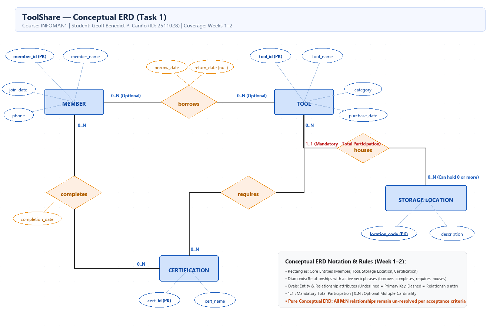
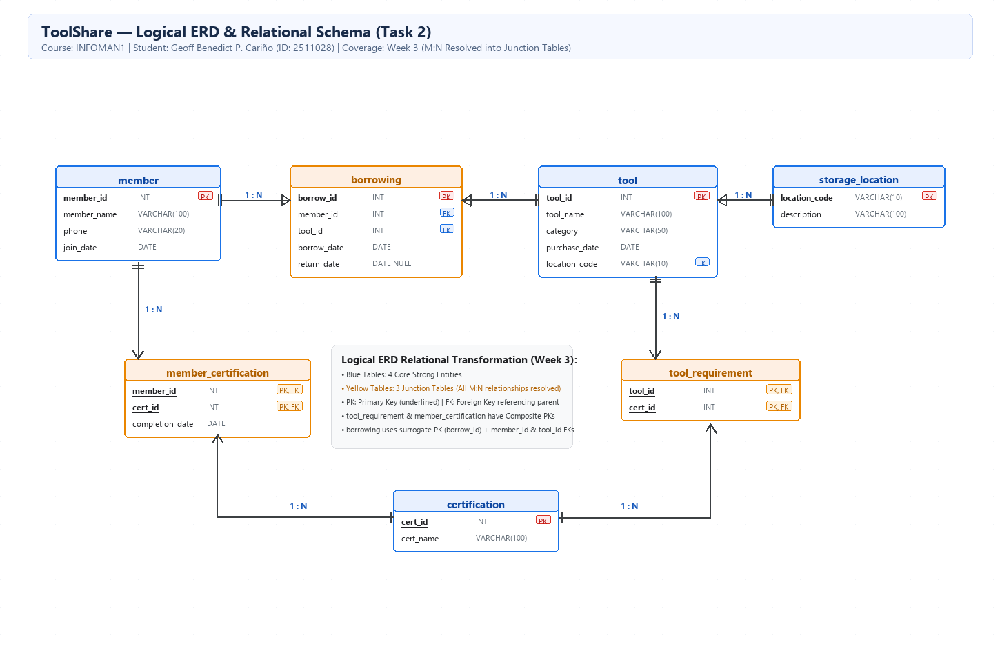

# INFOMAN1 — Prelim Lab Exam: ToolShare Relational Database Management System

**Student Name:** Geoff Benedict P. Cariño  
**Student ID:** 2511028  
**Course & Section:** Information Management 1 (INFOMAN1) — Prelim Lab Exam, BSIT - II  
**Database Name:** `toolshare_prelim`  
**GitHub Repository:** [https://github.com/geoxify/infoman1](https://github.com/geoxify/infoman1)  
**Submission Directory:** `infoman1/prelim/`  
**Walkthrough Video (YouTube Unlisted):** `[INSERT_UNLISTED_YOUTUBE_LINK_HERE]`  

---

## Executive Summary & Assessment Overview

This assessment synthesizes the core principles of relational database management systems mastered across Weeks 1 through 5:
1. **Conceptual ERD Design (Weeks 1–2):** Extracting business domain entities, attributes, and business rules from an unstructured specification and formalizing them in a conceptual Entity-Relationship Diagram using Crow's Foot notation without premature resolution.
2. **Logical ERD & Relational Schema Translation (Week 3):** Systematically resolving Many-to-Many ($M:N$) relationships into junction relations, identifying key structures, and expressing the relational database schema in standard formal notation (`TableName(<u>pk</u>, attr, fk [FK])`).
3. **MySQL DDL Implementation (Week 4):** Translating the logical schema into an ANSI-compliant, production-grade MySQL Data Definition Language script (`toolshare_prelim`), enforcing primary keys, foreign keys with referential integrity constraints (`ON UPDATE CASCADE ON DELETE RESTRICT`), and justifying specialized column data types.
4. **Data Query Language with WHERE Filtering (Week 5):** Formulating projection queries and Boolean predicates using equality, comparison, temporal filters, and Three-Valued Logic (`IS NULL`) against the instructor-supplied dataset.
5. **Cross-Week Mismatch Debugging (Weeks 3–5):** Diagnosing schema-level semantic failures where single-table query assumptions violate relational normalization boundaries, and authoring corrected multi-step queries.
6. **Video Walkthrough Demonstration:** Presenting and explaining the end-to-end design, implementation, and query execution in a recorded walkthrough.

---

## Task 1: Conceptual ERD (Weeks 1–2)

### 1.1 Specification Analysis & Candidate Entities

The scenario describes **ToolShare**, a community lending library. Analyzing the specification reveals four distinct real-world entities:

| Candidate Entity | Justification & Real-World Domain Semantics | Strong / Weak Status |
|---|---|---|
| **Member** | The system tracks residents who register and borrow tools. Each member possesses an independent identity (`member_id`), personal attributes, and membership lifecycle. | Strong Entity (independent identifier) |
| **Tool** | Physical equipment lent to members. Each tool has an independent inventory identity (`tool_id`), equipment specifications, and purchase records. | Strong Entity (independent identifier) |
| **Certification** | Official safety credentials administered or required by ToolShare. Each certification has an independent existence (`cert_id`) and name. | Strong Entity (independent identifier) |
| **Storage Location** | Physical workshop storage units (shelves, pegboards, cabinets). Each has an autonomous identity (`location_code`) and physical description. | Strong Entity (independent identifier) |

*Excluded Concepts:*
- "ToolShare": The operational environment/enterprise context, not an entity within the database.
- "Borrow Date", "Return Date": Attributes describing a specific loan transaction event occurring between a Member and a Tool, not autonomous entities at the conceptual stage.
- "Completion Date": An attribute describing the completion event when a Member acquires a Certification.

---

### 1.2 Entity Attribute Breakdown

| Entity | Attribute | Domain / Data Type Meaning | Key Classification |
|---|---|---|---|
| **Member** | `member_id` | Unique positive integer identifier | **Primary Key** |
| | `member_name` | Resident's full name (VARCHAR) | Simple, Stored |
| | `phone` | Mobile/landline contact string (VARCHAR) | Simple, Stored |
| | `join_date` | Date membership began (DATE) | Simple, Stored |
| **Tool** | `tool_id` | Unique positive integer identifier | **Primary Key** |
| | `tool_name` | Equipment title (e.g., "Circular Saw") | Simple, Stored |
| | `category` | Classification group (e.g., "Power Tools") | Simple, Stored |
| | `purchase_date` | Acquisition date (DATE) | Simple, Stored |
| **Storage Location** | `location_code` | Alphanumeric identifier (e.g., "A3", "B1") | **Primary Key** |
| | `description` | Location description text | Simple, Stored |
| **Certification** | `cert_id` | Unique numeric identifier | **Primary Key** |
| | `cert_name` | Name of safety course (e.g., "Chainsaw Safety") | Simple, Stored |

---

### 1.3 Relationship Analysis & Cardinality Specification

At the conceptual stage, all relationships are represented with descriptive verb phrases, and many-to-many relationships are **deliberately preserved without premature junction table decomposition**:

| Relationship | Between Entities | Cardinality | Participation | Scenario Justification & Business Rule |
|---|---|---|---|---|
| **borrows / is borrowed by** | `Member` ↔ `Tool` | **M:N** | Member: Optional ($0..N$)<br>Tool: Optional ($0..N$) | *"A member may borrow many tools over time, and a tool may be borrowed by many different members across its lifetime."*<br>**Relationship Attributes:** `borrow_date`, `return_date` (nullable for active loans). |
| **requires / is required by** | `Tool` ↔ `Certification` | **M:N** | Tool: Optional ($0..N$)<br>Certification: Optional ($0..N$) | *"Each certification may apply to multiple tools while each tool may require multiple certifications."* Some tools require zero certifications; certifications may apply to several tools. |
| **completes / completed by** | `Member` ↔ `Certification` | **M:N** | Member: Optional ($0..N$)<br>Certification: Optional ($0..N$) | *"When a member completes a certification, ToolShare records the completion date."* Members complete zero or more certs; certifications are completed by zero or more members.<br>**Relationship Attribute:** `completion_date`. |
| **houses / stored in** | `Storage Location` ↔ `Tool` | **1:N** | Location: Optional ($0..N$)<br>Tool: **Mandatory ($1..1$)** | *"Each tool belongs to exactly one storage location... Every tool must be assigned to a storage location (total participation). A storage location may hold zero or more tools."* |

---

### 1.4 Conceptual ERD Diagram Artifacts

- **Diagram File:** [`task1_conceptual_erd.drawio`](task1_conceptual_erd.drawio)
- **High-Resolution Export:** [`task1_conceptual_erd.png`](task1_conceptual_erd.png)



*Design Conformance:* All core entity types are present; all relationships feature active verb phrases and Crow's Foot cardinality markers on both ends; no $M:N$ relationship has been prematurely normalized into a physical junction table.

---

## Task 2: Logical ERD & Relational Schema (Week 3)

### 2.1 Transformation Rules & Junction Table Resolution

During the Week 3 logical design phase, the conceptual ERD is translated into the formal relational model by resolving all Many-to-Many relationships and foreign key dependencies:

1. **Resolution of `Member` ↔ `Tool` (`borrows`):**
   - Transformed into the associative relation `borrowing`.
   - Foreign keys: `member_id` referencing `member(member_id)` and `tool_id` referencing `tool(tool_id)`.
   - Relationship attributes embedded: `borrow_date` (NOT NULL) and `return_date` (NULL permitted for active loans).
   - Primary key strategy: An integer surrogate key `borrow_id` is utilized as the primary key.
2. **Resolution of `Tool` ↔ `Certification` (`requires`):**
   - Transformed into the junction relation `tool_requirement`.
   - Composite Primary Key: `(tool_id, cert_id)`.
   - Both columns serve as foreign keys referencing `tool(tool_id)` and `certification(cert_id)` respectively.
3. **Resolution of `Member` ↔ `Certification` (`completes`):**
   - Transformed into the junction relation `member_certification`.
   - Composite Primary Key: `(member_id, cert_id)`.
   - Foreign keys reference `member(member_id)` and `certification(cert_id)`.
   - Relationship attribute embedded: `completion_date` (DATE NOT NULL).
4. **Resolution of 1:N `Storage Location` ↔ `Tool` (`houses`):**
   - Foreign key migration: The primary key of the "1" side (`location_code` from `storage_location`) is migrated into the "N" side (`tool`).
   - Mandatory Total Participation: `tool.location_code` is constrained as `NOT NULL`.

---

### 2.2 Standard Relational Schema Notation

```text
storage_location(<u>location_code</u>, description)

member(<u>member_id</u>, member_name, phone, join_date)

tool(<u>tool_id</u>, tool_name, category, purchase_date, location_code [FK])

certification(<u>cert_id</u>, cert_name)

tool_requirement(<u>tool_id</u> [FK], <u>cert_id</u> [FK])

member_certification(<u>member_id</u> [FK], <u>cert_id</u> [FK], completion_date)

borrowing(<u>borrow_id</u>, member_id [FK], tool_id [FK], borrow_date, return_date)
```

- **Dedicated Documentation File:** [`task2_relational_schema.md`](task2_relational_schema.md)
- **Diagram File:** [`task2_logical_erd.drawio`](task2_logical_erd.drawio)
- **High-Resolution Export:** [`task2_logical_erd.png`](task2_logical_erd.png)



---

## Task 3: MySQL DDL Implementation (Week 4)

### 3.1 DDL Script Architecture (`task3_ddl.sql`)

The database `toolshare_prelim` was created with strict referential integrity. Foreign keys are declared with `ON UPDATE CASCADE ON DELETE RESTRICT` to prevent orphan records.

```sql
DROP DATABASE IF EXISTS toolshare_prelim;
CREATE DATABASE toolshare_prelim;
USE toolshare_prelim;

CREATE TABLE storage_location (
    location_code VARCHAR(10) NOT NULL,
    description VARCHAR(100) NOT NULL,
    CONSTRAINT pk_storage_location PRIMARY KEY (location_code)
) ENGINE=InnoDB;

CREATE TABLE member (
    member_id INT NOT NULL,
    member_name VARCHAR(100) NOT NULL,
    phone VARCHAR(20) NULL,
    join_date DATE NOT NULL,
    CONSTRAINT pk_member PRIMARY KEY (member_id)
) ENGINE=InnoDB;

CREATE TABLE tool (
    tool_id INT NOT NULL,
    tool_name VARCHAR(100) NOT NULL,
    category VARCHAR(50) NOT NULL,
    purchase_date DATE NOT NULL,
    location_code VARCHAR(10) NOT NULL,
    CONSTRAINT pk_tool PRIMARY KEY (tool_id),
    CONSTRAINT fk_tool_storage_location FOREIGN KEY (location_code)
        REFERENCES storage_location (location_code)
        ON UPDATE CASCADE
        ON DELETE RESTRICT
) ENGINE=InnoDB;

CREATE TABLE certification (
    cert_id INT NOT NULL,
    cert_name VARCHAR(100) NOT NULL,
    CONSTRAINT pk_certification PRIMARY KEY (cert_id)
) ENGINE=InnoDB;

CREATE TABLE tool_requirement (
    tool_id INT NOT NULL,
    cert_id INT NOT NULL,
    CONSTRAINT pk_tool_requirement PRIMARY KEY (tool_id, cert_id),
    CONSTRAINT fk_tr_tool FOREIGN KEY (tool_id)
        REFERENCES tool (tool_id)
        ON UPDATE CASCADE
        ON DELETE RESTRICT,
    CONSTRAINT fk_tr_cert FOREIGN KEY (cert_id)
        REFERENCES certification (cert_id)
        ON UPDATE CASCADE
        ON DELETE RESTRICT
) ENGINE=InnoDB;

CREATE TABLE member_certification (
    member_id INT NOT NULL,
    cert_id INT NOT NULL,
    completion_date DATE NOT NULL,
    CONSTRAINT pk_member_certification PRIMARY KEY (member_id, cert_id),
    CONSTRAINT fk_mc_member FOREIGN KEY (member_id)
        REFERENCES member (member_id)
        ON UPDATE CASCADE
        ON DELETE RESTRICT,
    CONSTRAINT fk_mc_cert FOREIGN KEY (cert_id)
        REFERENCES certification (cert_id)
        ON UPDATE CASCADE
        ON DELETE RESTRICT
) ENGINE=InnoDB;

CREATE TABLE borrowing (
    borrow_id INT NOT NULL,
    member_id INT NOT NULL,
    tool_id INT NOT NULL,
    borrow_date DATE NOT NULL,
    return_date DATE NULL,
    CONSTRAINT pk_borrowing PRIMARY KEY (borrow_id),
    CONSTRAINT fk_borrowing_member FOREIGN KEY (member_id)
        REFERENCES member (member_id)
        ON UPDATE CASCADE
        ON DELETE RESTRICT,
    CONSTRAINT fk_borrowing_tool FOREIGN KEY (tool_id)
        REFERENCES tool (tool_id)
        ON UPDATE CASCADE
        ON DELETE RESTRICT
) ENGINE=InnoDB;
```

---

### 3.2 Non-Obvious Data Type Justifications

1. **`location_code VARCHAR(10)` vs. `INT` or `CHAR(10)`:**  
   Physical storage locations in community workshops utilize alphanumeric identifiers (e.g., `'A3'`, `'B1'`, `'Pegboard 2'`). Defining this column as `INT` would strictly prohibit letters and prefixes. Furthermore, using `VARCHAR(10)` instead of fixed-length `CHAR(10)` conserves space and prevents unnecessary blank padding when short two-character codes (such as `'A3'`) are stored.
2. **`phone VARCHAR(20)` vs. `INT` or `BIGINT`:**  
   Phone numbers are non-computational textual data. Mobile phone numbers in the Philippines start with a leading zero (`09171234567`). If defined as `INT`, MySQL treats the input as a mathematical integer, automatically stripping the leading zero (`9171234567`), thereby corrupting the data. Standard signed 32-bit `INT` also overflows at $2,147,483,647$. Storing phone numbers as `VARCHAR(20)` preserves leading zeros and allows country codes (e.g., `+63`) or punctuation.
3. **`completion_date DATE` vs. `DATETIME`:**  
   Safety certification validity is legally tracked by calendar date, not by clock seconds. Using `DATE` (3 bytes) rather than `DATETIME` (5 bytes) saves storage across large junction indexes and prevents timestamp-comparison bugs when executing equality filters (`WHERE completion_date = '2025-03-01'`).
4. **`return_date DATE NULL`:**  
   The specification states: *"a tool currently on loan has a NULL return date."* Defining `return_date` as nullable allows active loans to be represented cleanly without relying on artificial sentinel values (like `'9999-12-31'`), enabling intuitive querying via `return_date IS NULL`.

---

### 3.3 Structural Verification (`task3_describe_output.txt`)

Below is the verified `DESCRIBE` output across all seven relations in `toolshare_prelim`:

```text
mysql> SHOW TABLES;
+----------------------------+
| Tables_in_toolshare_prelim |
+----------------------------+
| borrowing                  |
| certification              |
| member                     |
| member_certification       |
| storage_location           |
| tool                       |
| tool_requirement           |
+----------------------------+
7 rows in set (0.002 sec)

mysql> DESCRIBE storage_location;
+---------------+--------------+------+-----+---------+-------+
| Field         | Type         | Null | Key | Default | Extra |
+---------------+--------------+------+-----+---------+-------+
| location_code | varchar(10)  | NO   | PRI | NULL    |       |
| description   | varchar(100) | NO   |     | NULL    |       |
+---------------+--------------+------+-----+---------+-------+

mysql> DESCRIBE member;
+-------------+--------------+------+-----+---------+-------+
| Field       | Type         | Null | Key | Default | Extra |
+-------------+--------------+------+-----+---------+-------+
| member_id   | int          | NO   | PRI | NULL    |       |
| member_name | varchar(100) | NO   |     | NULL    |       |
| phone       | varchar(20)  | YES  |     | NULL    |       |
| join_date   | date         | NO   |     | NULL    |       |
+-------------+--------------+------+-----+---------+-------+

mysql> DESCRIBE tool;
+---------------+--------------+------+-----+---------+-------+
| Field         | Type         | Null | Key | Default | Extra |
+---------------+--------------+------+-----+---------+-------+
| tool_id       | int          | NO   | PRI | NULL    |       |
| tool_name     | varchar(100) | NO   |     | NULL    |       |
| category      | varchar(50)  | NO   |     | NULL    |       |
| purchase_date | date         | NO   |     | NULL    |       |
| location_code | varchar(10)  | NO   | MUL | NULL    |       |
+---------------+--------------+------+-----+---------+-------+

mysql> DESCRIBE certification;
+-----------+--------------+------+-----+---------+-------+
| Field     | Type         | Null | Key | Default | Extra |
+-----------+--------------+------+-----+---------+-------+
| cert_id   | int          | NO   | PRI | NULL    |       |
| cert_name | varchar(100) | NO   |     | NULL    |       |
+-----------+--------------+------+-----+---------+-------+

mysql> DESCRIBE tool_requirement;
+---------+------+------+-----+---------+-------+
| Field   | Type | Null | Key | Default | Extra |
+---------+------+------+-----+---------+-------+
| tool_id | int  | NO   | PRI | NULL    |       |
| cert_id | int  | NO   | PRI | NULL    |       |
+---------+------+------+-----+---------+-------+

mysql> DESCRIBE member_certification;
+-----------------+------+------+-----+---------+-------+
| Field           | Type | Null | Key | Default | Extra |
+-----------------+------+------+-----+---------+-------+
| member_id       | int  | NO   | PRI | NULL    |       |
| cert_id         | int  | NO   | PRI | NULL    |       |
| completion_date | date | NO   |     | NULL    |       |
+-----------------+------+------+-----+---------+-------+

mysql> DESCRIBE borrowing;
+-------------+------+------+-----+---------+-------+
| Field       | Type | Null | Key | Default | Extra |
+-------------+------+------+-----+---------+-------+
| borrow_id   | int  | NO   | PRI | NULL    |       |
| member_id   | int  | NO   | MUL | NULL    |       |
| tool_id     | int  | NO   | MUL | NULL    |       |
| borrow_date | date | NO   |     | NULL    |       |
| return_date | date | YES  |     | NULL    |       |
+-------------+------+------+-----+---------+-------+
```

---

## Task 4: Sample Data Queries (Week 5)

Using the populated `toolshare_sample_data.sql` dataset, five queries were executed:

### Query 1: Power Tools Category
```sql
SELECT tool_name, category
FROM tool
WHERE category = 'Power Tools';
```
**Output:**
```text
+----------------+-------------+
| tool_name      | category    |
+----------------+-------------+
| Cordless Drill | Power Tools |
| Circular Saw   | Power Tools |
| Angle Grinder  | Power Tools |
+----------------+-------------+
3 rows in set (0.00 sec)
```

### Query 2: Members Joining After January 1, 2025
```sql
SELECT member_id, member_name, phone, join_date
FROM member
WHERE join_date > '2025-01-01';
```
**Output:**
```text
+-----------+-------------+-------------+------------+
| member_id | member_name | phone       | join_date  |
+-----------+-------------+-------------+------------+
|         2 | Jose Rizal   | 09179876543 | 2025-02-10 |
|         3 | Ana Reyes   | 09172223333 | 2025-06-01 |
|         5 | Liza Gomez  | 09175556666 | 2025-01-15 |
|         6 | Kevin Lim   | 09176667777 | 2025-08-05 |
+-----------+-------------+-------------+------------+
4 rows in set (0.00 sec)
```

### Query 3: Active Loans Currently Checked Out
```sql
SELECT borrow_id, member_id, tool_id, borrow_date, return_date
FROM borrowing
WHERE return_date IS NULL;
```
**Output:**
```text
+-----------+-----------+---------+-------------+-------------+
| borrow_id | member_id | tool_id | borrow_date | return_date |
+-----------+-----------+---------+-------------+-------------+
|         2 |         1 |       2 | 2025-09-12  | NULL        |
|         3 |         2 |       7 | 2025-09-05  | NULL        |
+-----------+-----------+---------+-------------+-------------+
2 rows in set (0.00 sec)
```

### Query 4: Borrowing Records for Member ID = 1
```sql
SELECT borrow_id, member_id, tool_id, borrow_date, return_date
FROM borrowing
WHERE member_id = 1;
```
**Output:**
```text
+-----------+-----------+---------+-------------+-------------+
| borrow_id | member_id | tool_id | borrow_date | return_date |
+-----------+-----------+---------+-------------+-------------+
|         1 |         1 |       1 | 2025-09-01  | 2025-09-10  |
|         2 |         1 |       2 | 2025-09-12  | NULL        |
+-----------+-----------+---------+-------------+-------------+
2 rows in set (0.00 sec)
```

### Query 5: Tools Purchased Before January 1, 2024
```sql
SELECT tool_id, tool_name, category, purchase_date, location_code
FROM tool
WHERE purchase_date < '2024-01-01';
```
**Output:**
```text
+---------+----------------+-------------+---------------+---------------+
| tool_id | tool_name      | category    | purchase_date | location_code |
+---------+----------------+-------------+---------------+---------------+
|       1 | Cordless Drill | Power Tools | 2023-05-10    | A3            |
|       2 | Circular Saw   | Power Tools | 2023-08-22    | A3            |
|       4 | Garden Shovel  | Garden      | 2023-12-01    | B1            |
+---------+----------------+-------------+---------------+---------------+
3 rows in set (0.00 sec)
```

- **Dedicated Query Script:** [`task4_queries.sql`](task4_queries.sql)

---

## Task 5: Debug a Cross-Week Mismatch (Weeks 3–5)

### 5.1 Diagnosis: Why the Provided Query Fails

The instructor provided the following query intended to retrieve borrowing records for "Maria Santos":

```sql
SELECT borrow_date, return_date
FROM borrowing
WHERE member_name = 'Maria Santos';
```

When executed in MySQL, the query immediately aborts with:
```text
ERROR 1054 (42S22): Unknown column 'member_name' in 'where clause'
```

#### Detailed Root-Cause Analysis Across Weeks:
1. **Week 3 (Relational Normalization & Entity Separation):**  
   In relational database design, data must be placed in the entity to which it functionally belongs. `member_name` is an attribute of the resident entity (`member`), whereas `borrowing` is an associative entity recording a loan transaction. Storing `member_name` inside `borrowing` would introduce data redundancy, violating Second and Third Normal Forms (2NF/3NF). As designed in Task 2, `borrowing` stores only the foreign key `member_id`.
2. **Week 4 (DDL Physical Catalog Verification):**  
   In the DDL script (`task3_ddl.sql`), the `borrowing` table was created with five columns: `borrow_id`, `member_id`, `tool_id`, `borrow_date`, and `return_date`. Running `DESCRIBE borrowing;` proves that no column named `member_name` exists in this relation.
3. **Week 5 (SQL Compiler Predicate Scoping):**  
   A SQL `WHERE` clause can only evaluate predicates against columns physically defined in the table(s) listed in the `FROM` clause. Because `borrowing` does not contain `member_name`, MySQL's query parser halts compilation.

---

### 5.2 Corrected Multi-Step Single-Table Queries

Under Week 5 constraints (single-table `SELECT` statements with `WHERE` clauses without `JOIN`), the lookup must be executed in two steps:

#### Step 1: Look up Maria Santos's `member_id` from the `member` table
```sql
SELECT member_id
FROM member
WHERE member_name = 'Maria Santos';
```
**Execution Output:**
```text
+-----------+
| member_id |
+-----------+
|         1 |
+-----------+
1 row in set (0.00 sec)
```

#### Step 2: Query `borrowing` using the resolved `member_id = 1`
```sql
SELECT borrow_date, return_date
FROM borrowing
WHERE member_id = 1;
```
**Execution Output:**
```text
+-------------+-------------+
| borrow_date | return_date |
+-------------+-------------+
| 2025-09-01  | 2025-09-10  |
| 2025-09-12  | NULL        |
+-------------+-------------+
2 rows in set (0.00 sec)
```

Both borrowing events for Maria Santos are retrieved accurately (one returned, one currently active on loan).

---

### 5.3 Week 5 Concepts Illustrated

1. **Foreign Key Dereferencing in Single-Table DQL:**  
   In normalized databases, human-readable descriptors (`member_name`) are decoupled from transactional foreign keys (`member_id`). Without SQL `JOIN` clauses, querying across related tables requires a two-step dereferencing process.
2. **Strict Attribute Resolution Scope:**  
   The `FROM` clause defines the tuple stream available to the query processor. The `WHERE` clause cannot filter on attributes beyond that relation's relational projection.
3. **Primary Key / Foreign Key Integrity:**  
   `member_id = 1` acts as the bridge connecting the entity instance in `member` to its child records in `borrowing`.

---

## Task 6: Video Walkthrough & Presentation Script

### 6.1 Walkthrough Video Information
- **Video Link:** `[INSERT_UNLISTED_YOUTUBE_LINK_HERE]`
- **Target Duration:** ~8 to 12 minutes (under 15-minute exam threshold)
- **Presenter:** Geoff Benedict P. Cariño

---

### 6.2 Structured Presentation Outline & Script

| Section & Timecode | Deliverable Shown | Key Spoken Points & Academic Justifications |
|---|---|---|
| **0:00 – 1:30**<br>Introduction & Spec Overview | Title screen & `task1_conceptual_erd.png` | - Introduce yourself (Geoff Benedict P. Cariño, INFOMAN1 Prelim Exam).<br>- Summarize the ToolShare scenario: community library, tracking members, tools, storage locations, safety certifications, and loans.<br>- Explain why Member, Tool, Storage Location, and Certification are the 4 strong entities. |
| **1:30 – 3:30**<br>Task 1: Conceptual ERD | `task1_conceptual_erd.drawio` in draw.io / PNG | - Point out all entities and their attributes (underlined PKs).<br>- Explain the verb phrases and Crow's Foot cardinalities: `borrows` ($M:N$), `requires` ($M:N$), `completes` ($M:N$), and `houses` ($1:N$).<br>- Emphasize mandatory total participation on Tool to Storage Location ($1..1$) vs. optional location side ($0..N$).<br>- Highlight why $M:N$ relationships are NOT resolved yet (acceptance criteria rule). |
| **3:30 – 5:30**<br>Task 2: Logical ERD & Relational Schema | `task2_logical_erd.drawio` & `task2_relational_schema.md` | - Walk through resolving $M:N$ relationships into 3 junction tables: `borrowing`, `tool_requirement`, and `member_certification`.<br>- Explain composite primary keys: `(tool_id, cert_id)` and `(member_id, cert_id)`.<br>- Explain surrogate key `borrow_id` for loans.<br>- Read through standard relational schema notation with underlined PKs and marked FKs. |
| **5:30 – 7:30**<br>Task 3: Live MySQL DDL Verification | Terminal / MySQL Workbench (`USE toolshare_prelim;`) | - Show `task3_ddl.sql` and run `SHOW TABLES;`.<br>- Run `DESCRIBE` on all 7 tables.<br>- Verbally justify at least 2 non-obvious data types:<br>  1. `phone VARCHAR(20)` instead of `INT` (prevents loss of leading zeros in Philippine mobile numbers and allows formatting).<br>  2. `location_code VARCHAR(10)` instead of `INT` (supports alphanumeric shelving codes like "A3").<br>  3. `return_date DATE NULL` (models active loans). |
| **7:30 – 9:30**<br>Task 4: Executing the 5 DQL Queries | Terminal executing `task4_queries.sql` | - Run Query 1: Power Tools category filter.<br>- Run Query 2: Members joining after `2025-01-01` ($>$ comparison operator).<br>- Run Query 3: Active loans with `return_date IS NULL` (Three-Valued Logic).<br>- Run Query 4: Borrowing records for `member_id = 1`.<br>- Run Query 5: Tools purchased before `2024-01-01` ($<$ operator).<br>- Confirm non-empty results for all 5 queries. |
| **9:30 – 11:30**<br>Task 5: Diagnosing & Correcting the Mismatch | Terminal running broken vs. corrected queries | - Display the broken query: `WHERE member_name = 'Maria Santos'`.<br>- Show the MySQL error: `Unknown column 'member_name' in 'where clause'`.<br>- Explain the Week 3 schema reason (normalization, `member_name` is in `member`, not `borrowing`) and Week 4 DDL columns.<br>- Execute the corrected 2-step single-table queries live.<br>- Explain Week 5 foreign key dereferencing concept. |
| **11:30 – 12:00**<br>Conclusion & Wrap-Up | Git repository view | - Summarize how the deliverables link across Weeks 1–5.<br>- Show files in `infoman1/prelim/`. |

---

## Submission Checklist

- [x] Dedicated folder created: `infoman1/prelim/`
- [x] Task 1: `task1_conceptual_erd.drawio` & `task1_conceptual_erd.png`
- [x] Task 2: `task2_logical_erd.drawio` & `task2_logical_erd.png`
- [x] Task 2: `task2_relational_schema.md`
- [x] Task 3: `task3_ddl.sql` & `task3_describe_output.txt`
- [x] Task 4: `task4_queries.sql`
- [x] Task 5: Detailed cross-week error diagnosis and corrected queries in `prelim_lab_answers.md`
- [x] Task 6: Video Walkthrough script, timecodes, and talking points prepared
- [x] Instructor sample data script preserved: `toolshare_sample_data.sql`
- [x] Persistent GitHub repository: [https://github.com/geoxify/infoman1](https://github.com/geoxify/infoman1)
