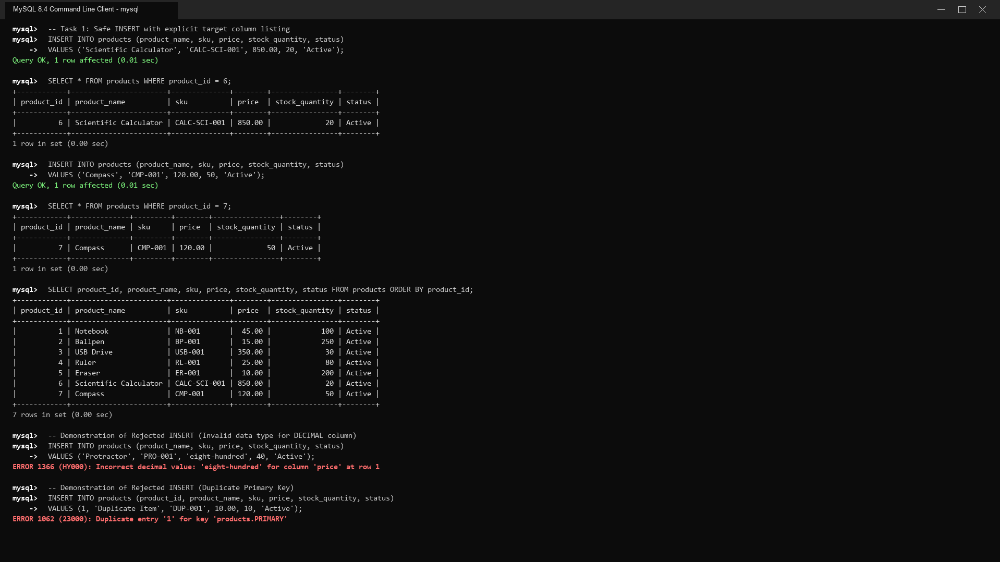
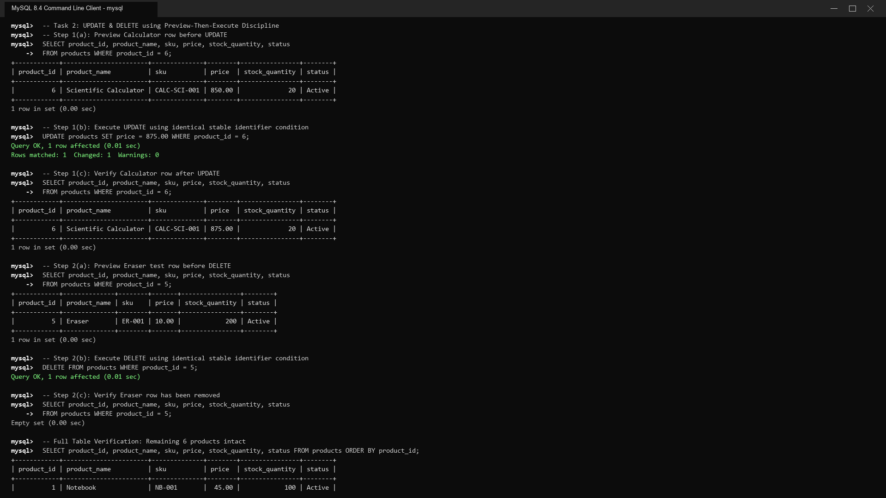

# INFOMAN1 — Week 10 Lab Answers

Name: Geoff Benedict Cariño  
Student ID: 2511028  
GitHub repo: https://github.com/geoxify/infoman1  
Date submitted: November 12, 2026  

---

**Database Setup Verification:**  
Database: `infoman1_bookstore`  
Schema Tables: `products`, `sales`, `employees`, `colors`, `sizes`  


```text
mysql> CREATE DATABASE IF NOT EXISTS infoman1_bookstore;
Query OK, 1 row affected (0.00 sec)

mysql> USE infoman1_bookstore;
Database changed

mysql> SOURCE infoman1_bookstore.sql;
Query OK, 0 rows affected (0.01 sec)
Query OK, 0 rows affected (0.01 sec)
Query OK, 0 rows affected (0.01 sec)
Query OK, 0 rows affected (0.01 sec)
Query OK, 0 rows affected (0.01 sec)
Query OK, 5 rows affected (0.01 sec)
Records: 5  Duplicates: 0  Warnings: 0
Query OK, 2 rows affected (0.01 sec)
Records: 2  Duplicates: 0  Warnings: 0
Query OK, 3 rows affected (0.01 sec)
Records: 3  Duplicates: 0  Warnings: 0
Query OK, 3 rows affected (0.01 sec)
Records: 3  Duplicates: 0  Warnings: 0
Query OK, 3 rows affected (0.01 sec)
Records: 3  Duplicates: 0  Warnings: 0

mysql> SHOW TABLES;
+------------------------------+
| Tables_in_infoman1_bookstore |
+------------------------------+
| colors                       |
| employees                    |
| products                     |
| sales                        |
| sizes                        |
+------------------------------+
5 rows in set (0.00 sec)

mysql> SELECT COUNT(*) AS products_count FROM products;
+----------------+
| products_count |
+----------------+
|              5 |
+----------------+
1 row in set (0.00 sec)

mysql> SELECT COUNT(*) AS sales_count FROM sales;
+-------------+
| sales_count |
+-------------+
|           2 |
+-------------+
1 row in set (0.00 sec)

mysql> SELECT COUNT(*) AS employees_count FROM employees;
+-----------------+
| employees_count |
+-----------------+
|               3 |
+-----------------+
1 row in set (0.00 sec)
```

---

## Task 1 — Safe INSERT

**Approach / explanation:**  
To solve Task 1, I performed explicit-column insertions to add the Scientific Calculator and Compass into the `products` table. By explicitly enumerating target columns (`product_name`, `sku`, `price`, `stock_quantity`, `status`) in the `INSERT INTO` clause, I decoupled the statements from physical column positioning and allowed the `AUTO_INCREMENT` sequence generator to handle `product_id` safely. Immediately following each insertion, I executed a dedicated `SELECT` query filtered on the assigned primary key to confirm record persistence, followed by a full-table query showing all 7 products. Finally, I documented two candidate insert statements that MySQL rejects due to data type mismatch (`DECIMAL` receiving a string) and primary key duplication.

**Code / query used (if applicable):**
```sql
-- 1.1: Insert Scientific Calculator with explicit target columns
INSERT INTO products (product_name, sku, price, stock_quantity, status)
VALUES ('Scientific Calculator', 'CALC-SCI-001', 850.00, 20, 'Active');

-- 1.1b: Confirm Scientific Calculator insert
SELECT * 
FROM products 
WHERE product_id = 6;

-- 1.2: Insert Compass with explicit target columns
INSERT INTO products (product_name, sku, price, stock_quantity, status)
VALUES ('Compass', 'CMP-001', 120.00, 50, 'Active');

-- 1.2b: Confirm Compass insert
SELECT * 
FROM products 
WHERE product_id = 7;

-- 1.3: Verification of all 7 catalog products
SELECT 
    product_id,
    product_name,
    sku,
    price,
    stock_quantity,
    status
FROM products
ORDER BY product_id;

-- 1.4: Rejected INSERT Demonstration 1 — Data Type Mismatch
-- MySQL rejects non-numeric string literal into DECIMAL column
INSERT INTO products (product_name, sku, price, stock_quantity, status)
VALUES ('Protractor', 'PRO-001', 'eight-hundred', 40, 'Active');
-- ERROR 1366 (HY000): Incorrect decimal value: 'eight-hundred' for column 'price' at row 1

-- 1.5: Rejected INSERT Demonstration 2 — Primary Key Violation
-- MySQL rejects duplicate primary key value on AUTO_INCREMENT primary key
INSERT INTO products (product_id, product_name, sku, price, stock_quantity, status)
VALUES (1, 'Duplicate Item', 'DUP-001', 10.00, 10, 'Active');
-- ERROR 1062 (23000): Duplicate entry '1' for key 'products.PRIMARY'
```

**Evidence (screenshot filename, output, or file reference in this folder):**  


```text
mysql> -- Task 1: Safe INSERT with explicit target column listing
mysql> INSERT INTO products (product_name, sku, price, stock_quantity, status)
    -> VALUES ('Scientific Calculator', 'CALC-SCI-001', 850.00, 20, 'Active');
Query OK, 1 row affected (0.01 sec)

mysql> SELECT * FROM products WHERE product_id = 6;
+------------+-----------------------+--------------+--------+----------------+--------+
| product_id | product_name          | sku          | price  | stock_quantity | status |
+------------+-----------------------+--------------+--------+----------------+--------+
|          6 | Scientific Calculator | CALC-SCI-001 | 850.00 |             20 | Active |
+------------+-----------------------+--------------+--------+----------------+--------+
1 row in set (0.00 sec)

mysql> INSERT INTO products (product_name, sku, price, stock_quantity, status)
    -> VALUES ('Compass', 'CMP-001', 120.00, 50, 'Active');
Query OK, 1 row affected (0.01 sec)

mysql> SELECT * FROM products WHERE product_id = 7;
+------------+--------------+---------+--------+----------------+--------+
| product_id | product_name | sku     | price  | stock_quantity | status |
+------------+--------------+---------+--------+----------------+--------+
|          7 | Compass      | CMP-001 | 120.00 |             50 | Active |
+------------+--------------+---------+--------+----------------+--------+
1 row in set (0.00 sec)

mysql> SELECT product_id, product_name, sku, price, stock_quantity, status FROM products ORDER BY product_id;
+------------+-----------------------+--------------+--------+----------------+--------+
| product_id | product_name          | sku          | price  | stock_quantity | status |
+------------+-----------------------+--------------+--------+----------------+--------+
|          1 | Notebook              | NB-001       |  45.00 |            100 | Active |
|          2 | Ballpen               | BP-001       |  15.00 |            250 | Active |
|          3 | USB Drive             | USB-001      | 350.00 |             30 | Active |
|          4 | Ruler                 | RL-001       |  25.00 |             80 | Active |
|          5 | Eraser                | ER-001       |  10.00 |            200 | Active |
|          6 | Scientific Calculator | CALC-SCI-001 | 850.00 |             20 | Active |
|          7 | Compass               | CMP-001      | 120.00 |             50 | Active |
+------------+-----------------------+--------------+--------+----------------+--------+
7 rows in set (0.00 sec)

mysql> -- Demonstration of Rejected INSERT (Invalid data type for DECIMAL column)
mysql> INSERT INTO products (product_name, sku, price, stock_quantity, status)
    -> VALUES ('Protractor', 'PRO-001', 'eight-hundred', 40, 'Active');
ERROR 1366 (HY000): Incorrect decimal value: 'eight-hundred' for column 'price' at row 1

mysql> -- Demonstration of Rejected INSERT (Duplicate Primary Key)
mysql> INSERT INTO products (product_id, product_name, sku, price, stock_quantity, status)
    -> VALUES (1, 'Duplicate Item', 'DUP-001', 10.00, 10, 'Active');
ERROR 1062 (23000): Duplicate entry '1' for key 'products.PRIMARY'
```

**Reflection question:**  
*Why does listing target columns explicitly make an INSERT safer, and what fills in for columns you omit?*

1. **Schema Resilience and Positional Independence:**  
   Listing target columns explicitly (`INSERT INTO products (col1, col2) VALUES (...)`) creates an immutable semantic contract between the SQL statement and the database engine. In contrast, positional inserts (`INSERT INTO products VALUES (...)`) rely entirely on the exact physical order of columns as defined during table creation. If a DBA later alters the table—such as adding a `barcode` column, reordering columns, or inserting metadata fields—positional statements will either crash with data type errors or silently write data into incorrect attributes (e.g., writing a description string into an address field). Explicit column lists insulate applications from schema evolution.

2. **Column Omission Semantics:**  
   When a column is omitted from an explicit `INSERT` statement, the database storage engine determines its populated value through a strict four-tier hierarchy:
   - **`AUTO_INCREMENT` / Identity Sequence:** If the omitted column is an auto-incrementing surrogate primary key (such as `product_id`), the engine computes and assigns the next monotonic integer value.
   - **Declared `DEFAULT` Constraint:** If a default clause was specified (e.g., `status VARCHAR(20) DEFAULT 'Active'`), the DBMS automatically substitutes that defined literal or expression.
   - **`NULL` Value:** If the column is nullable and has no declared default, the DBMS writes an explicit SQL `NULL`.
   - **Rejection under Strict SQL Mode:** If the omitted column is defined as `NOT NULL` without an `AUTO_INCREMENT` or `DEFAULT` definition, MySQL running in default strict mode (`STRICT_TRANS_TABLES`) halts execution and rejects the write with `ERROR 1364 (HY000): Field '...' doesn't have a default value`.

---

## Task 2 — UPDATE & DELETE Without Collateral Damage

**Approach / explanation:**  
To safely update the Calculator price to 875.00 and delete the Eraser test record, I implemented the preview-then-execute discipline. For each data manipulation operation, I first constructed a read-only `SELECT` query utilizing the exact predicate targeted at the entity's stable primary key identifier (`product_id = 6` and `product_id = 5`) to isolate and preview the candidate row before mutation. Once confirmed, I executed the `UPDATE` and `DELETE` statements with that identical identifier, preventing collateral damage to neighboring records. Finally, I verified the resulting table state with post-execution `SELECT` queries, proving that the Calculator price changed accurately, the Eraser was removed, and the remaining six catalog items remained intact.

**Code / query used (if applicable):**
```sql
-- -----------------------------------------------------------------------------
-- Part 1: Correct Scientific Calculator price from 850.00 to 875.00
-- -----------------------------------------------------------------------------

-- Step 1(a): Preview target row before UPDATE
SELECT 
    product_id,
    product_name,
    sku,
    price,
    stock_quantity,
    status
FROM products
WHERE product_id = 6;

-- Step 1(b): Execute UPDATE with identical stable identifier
UPDATE products
SET price = 875.00
WHERE product_id = 6;

-- Step 1(c): Verify Calculator record after UPDATE
SELECT 
    product_id,
    product_name,
    sku,
    price,
    stock_quantity,
    status
FROM products
WHERE product_id = 6;

-- -----------------------------------------------------------------------------
-- Part 2: Remove Eraser test row (product_id = 5)
-- -----------------------------------------------------------------------------

-- Step 2(a): Preview target row before DELETE
SELECT 
    product_id,
    product_name,
    sku,
    price,
    stock_quantity,
    status
FROM products
WHERE product_id = 5;

-- Step 2(b): Execute DELETE with identical stable identifier
DELETE FROM products
WHERE product_id = 5;

-- Step 2(c): Verify Eraser removal (returns Empty set)
SELECT 
    product_id,
    product_name,
    sku,
    price,
    stock_quantity,
    status
FROM products
WHERE product_id = 5;

-- Step 2(d): Full Table Verification (6 products remaining)
SELECT 
    product_id,
    product_name,
    sku,
    price,
    stock_quantity,
    status
FROM products
ORDER BY product_id;
```

**Evidence (screenshot filename, output, or file reference in this folder):**  


```text
mysql> -- Task 2: UPDATE & DELETE using Preview-Then-Execute Discipline
mysql> -- Step 1(a): Preview Calculator row before UPDATE
mysql> SELECT product_id, product_name, sku, price, stock_quantity, status
    -> FROM products WHERE product_id = 6;
+------------+-----------------------+--------------+--------+----------------+--------+
| product_id | product_name          | sku          | price  | stock_quantity | status |
+------------+-----------------------+--------------+--------+----------------+--------+
|          6 | Scientific Calculator | CALC-SCI-001 | 850.00 |             20 | Active |
+------------+-----------------------+--------------+--------+----------------+--------+
1 row in set (0.00 sec)

mysql> -- Step 1(b): Execute UPDATE using identical stable identifier condition
mysql> UPDATE products SET price = 875.00 WHERE product_id = 6;
Query OK, 1 row affected (0.01 sec)
Rows matched: 1  Changed: 1  Warnings: 0

mysql> -- Step 1(c): Verify Calculator row after UPDATE
mysql> SELECT product_id, product_name, sku, price, stock_quantity, status
    -> FROM products WHERE product_id = 6;
+------------+-----------------------+--------------+--------+----------------+--------+
| product_id | product_name          | sku          | price  | stock_quantity | status |
+------------+-----------------------+--------------+--------+----------------+--------+
|          6 | Scientific Calculator | CALC-SCI-001 | 875.00 |             20 | Active |
+------------+-----------------------+--------------+--------+----------------+--------+
1 row in set (0.00 sec)

mysql> -- Step 2(a): Preview Eraser test row before DELETE
mysql> SELECT product_id, product_name, sku, price, stock_quantity, status
    -> FROM products WHERE product_id = 5;
+------------+--------------+--------+-------+----------------+--------+
| product_id | product_name | sku    | price | stock_quantity | status |
+------------+--------------+--------+-------+----------------+--------+
|          5 | Eraser       | ER-001 | 10.00 |            200 | Active |
+------------+--------------+--------+-------+----------------+--------+
1 row in set (0.00 sec)

mysql> -- Step 2(b): Execute DELETE using identical stable identifier condition
mysql> DELETE FROM products WHERE product_id = 5;
Query OK, 1 row affected (0.01 sec)

mysql> -- Step 2(c): Verify Eraser row has been removed
mysql> SELECT product_id, product_name, sku, price, stock_quantity, status
    -> FROM products WHERE product_id = 5;
Empty set (0.00 sec)

mysql> -- Full Table Verification: Remaining 6 products intact
mysql> SELECT product_id, product_name, sku, price, stock_quantity, status FROM products ORDER BY product_id;
+------------+-----------------------+--------------+--------+----------------+--------+
| product_id | product_name          | sku          | price  | stock_quantity | status |
+------------+-----------------------+--------------+--------+----------------+--------+
|          1 | Notebook              | NB-001       |  45.00 |            100 | Active |
|          2 | Ballpen               | BP-001       |  15.00 |            250 | Active |
|          3 | USB Drive             | USB-001      | 350.00 |             30 | Active |
|          4 | Ruler                 | RL-001       |  25.00 |             80 | Active |
|          6 | Scientific Calculator | CALC-SCI-001 | 875.00 |             20 | Active |
|          7 | Compass               | CMP-001      | 120.00 |             50 | Active |
+------------+-----------------------+--------------+--------+----------------+--------+
6 rows in set (0.00 sec)
```

**Reflection question:**  
*What would your UPDATE and DELETE have done without their WHERE clauses, and why is a stable identifier safer than a name?*

1. **Consequence of Missing WHERE Clauses:**  
   - If executed as `UPDATE products SET price = 875.00;` without a `WHERE` clause, the SQL engine applies the mutation unconditionally across the entire relation. Every product in the bookstore—notebooks, ballpens, rulers, and USB drives—would have its price overwritten to 875.00. This causes catastrophic catalog corruption that destroys inventory pricing history and halts commerce.
   - If executed as `DELETE FROM products;` without a `WHERE` clause, the engine deletes every record from the table sequentially (or truncates the data pages), causing total and permanent data loss of all catalog records.

2. **Why a Stable Identifier is Superior to a Descriptive Name:**  
   - Descriptive names (`product_name`) are mutable business attributes that lack uniqueness guarantees in production schemas. Multiple distinct items can share identical or near-identical names (e.g., "Notebook" spiral vs. composition, or multiple entries created by different department vendors). Furthermore, names are vulnerable to subtle collation quirks, trailing whitespace differences, casing inconsistencies, and typographical errors.
   - In contrast, a primary key (`product_id`) is a stable, immutable, numeric surrogate identifier backed by a unique B-Tree index. Targeting `product_id = 6` guarantees that the query planner locates and modifies strictly the single intended tuple with zero ambiguity and zero collateral risk.

---

## Task 3 — Self Join & Cross Join

**Approach / explanation:**  
For Task 3(a), I built a hierarchical self-join query querying the `employees` table twice, assigning aliases `e` for subordinate employees and `m` for their respective supervisors. By applying a `LEFT JOIN` on `e.manager_id = m.employee_id`, the query successfully retains top manager Lea Ramos (whose `manager_id` is `NULL`) on the organizational chart alongside Carlo Reyes and Dana Cruz. For Task 3(b), I constructed a `CROSS JOIN` between `colors` (3 records) and `sizes` (3 records) to produce an exhaustive Cartesian product of 9 color-size permutations, validating the total count via `COUNT(*)`.

**Code / query used (if applicable):**
```sql
-- Query 3(a): Self Join of employees (e) and managers (m) using LEFT JOIN
SELECT 
    e.employee_id,
    e.employee_name,
    e.manager_id,
    m.employee_name AS manager_name
FROM employees AS e
LEFT JOIN employees AS m 
    ON e.manager_id = m.employee_id
ORDER BY e.employee_id;

-- Query 3(b): Deliberate CROSS JOIN of colors and sizes
SELECT 
    c.color_name,
    s.size_name
FROM colors AS c
CROSS JOIN sizes AS s
ORDER BY c.color_name, s.size_name;

-- Query 3(b) Count Verification:
SELECT COUNT(*) AS total_combinations
FROM colors
CROSS JOIN sizes;
```

**Evidence (screenshot filename, output, or file reference in this folder):**  


```text
mysql> -- Task 3(a): Self Join of employees (e) and managers (m) using LEFT JOIN
mysql> SELECT 
    ->     e.employee_id,
    ->     e.employee_name,
    ->     e.manager_id,
    ->     m.employee_name AS manager_name
    -> FROM employees AS e
    -> LEFT JOIN employees AS m 
    ->     ON e.manager_id = m.employee_id
    -> ORDER BY e.employee_id;
+-------------+---------------+------------+--------------+
| employee_id | employee_name | manager_id | manager_name |
+-------------+---------------+------------+--------------+
|           1 | Lea Ramos     |       NULL | NULL         |
|           2 | Carlo Reyes   |          1 | Lea Ramos    |
|           3 | Dana Cruz     |          1 | Lea Ramos    |
+-------------+---------------+------------+--------------+
3 rows in set (0.00 sec)

mysql> -- Task 3(b): CROSS JOIN between colors and sizes generating variant matrix
mysql> SELECT 
    ->     c.color_name,
    ->     s.size_name
    -> FROM colors AS c
    -> CROSS JOIN sizes AS s
    -> ORDER BY c.color_name, s.size_name;
+------------+-----------+
| color_name | size_name |
+------------+-----------+
| Blue       | L         |
| Blue       | M         |
| Blue       | S         |
| Green      | L         |
| Green      | M         |
| Green      | S         |
| Red        | L         |
| Red        | M         |
| Red        | S         |
+------------+-----------+
9 rows in set (0.00 sec)

mysql> -- Row count verification of CROSS JOIN (3 colors x 3 sizes = 9 permutations)
mysql> SELECT COUNT(*) AS total_combinations FROM colors CROSS JOIN sizes;
+--------------------+
| total_combinations |
+--------------------+
|                  9 |
+--------------------+
1 row in set (0.00 sec)
```

**Reflection question:**  
*Why does the self join need two aliases and a LEFT JOIN, and when is a CROSS JOIN the deliberate choice rather than a missing ON?*

1. **Why Self Joins Require Two Aliases and a LEFT JOIN:**  
   - **Dual Table Aliases:** When a query joins a relation to itself, the database engine must instantiate two independent logical references to the same underlying physical data structure. Table aliases (`e` and `m`) provide distinct syntactic namespaces. Without them, column references like `employee_name` or `manager_id` would be entirely ambiguous to the SQL parser and compiler.
   - **Preservation via `LEFT JOIN`:** Lea Ramos is the highest-ranking manager and has `manager_id = NULL`. In SQL ternary logic, comparing `NULL` with any value (`NULL = m.employee_id`) evaluates to `UNKNOWN`. Because an `INNER JOIN` discards candidate rows whose join predicate evaluates to `FALSE` or `UNKNOWN`, an inner join would silently drop Lea Ramos from the corporate directory. Using a `LEFT JOIN` ensures that all subordinate rows in `e` are preserved, populating manager attributes with `NULL` for top leadership.

2. **When CROSS JOIN is Deliberate vs. an Accidental Missing ON:**  
   - **Deliberate Business Application:** A `CROSS JOIN` produces the complete mathematical Cartesian product ($M \times N$). This is the deliberate and necessary pattern when generating exhaustive permutation matrices, such as pre-generating all 9 color-size inventory SKU combinations for campus apparel or notebooks, establishing testing matrices, or building scheduling grids.
   - **The Threat of an Accidental Missing ON:** In transactional queries between related business entities (e.g., customers and orders), omitting the `ON` clause or `WHERE` condition causes an unintentional Cartesian product. Joining 10,000 customers with 50,000 orders produces $500,000,000$ intermediate tuples. This accidental multiplication floods buffer pools, spikes CPU and disk I/O to 100%, exhausts server memory, and crashes production databases.

---

## Task 4 — Constraints & Table Evolution

**Approach / explanation:**  
To evolve the bookstore schema, I first executed `ALTER TABLE products ADD COLUMN contact_number VARCHAR(20);` and verified the new structure with `DESCRIBE products;`. Next, I enforced three critical bookstore data integrity constraints: `product_name NOT NULL` using `MODIFY COLUMN`, `sku UNIQUE` using `ADD CONSTRAINT ... UNIQUE`, and `CHECK (price > 0)` using `ADD CONSTRAINT ... CHECK`. For each constraint, I verified enforcement by running two distinct write operations: a valid write that passed successfully, and an invalid write that the MySQL engine actively blocked, generating specific error codes (Error 1048 for null values, Error 1062 for duplicate SKUs, and Error 3819 for check constraint violations).

**Code / query used (if applicable):**
```sql
-- -----------------------------------------------------------------------------
-- Step 4(a): Table Evolution — Add contact_number column
-- -----------------------------------------------------------------------------
ALTER TABLE products 
ADD COLUMN contact_number VARCHAR(20);

DESCRIBE products;

-- -----------------------------------------------------------------------------
-- Step 4(b) Rule 1: Enforce product_name NOT NULL
-- -----------------------------------------------------------------------------
ALTER TABLE products 
MODIFY COLUMN product_name VARCHAR(100) NOT NULL;

-- Rule 1: Valid write that passes
INSERT INTO products (product_name, sku, price, stock_quantity, status, contact_number)
VALUES ('Stapler', 'STP-001', 150.00, 40, 'Active', '0917-111-2222');

-- Rule 1: Invalid write rejected by database
-- ERROR 1048 (23000): Column 'product_name' cannot be null
INSERT INTO products (product_name, sku, price, stock_quantity, status, contact_number)
VALUES (NULL, 'INV-NAME-001', 50.00, 10, 'Active', '0917-000-0000');

-- -----------------------------------------------------------------------------
-- Step 4(b) Rule 2: Enforce sku UNIQUE
-- -----------------------------------------------------------------------------
ALTER TABLE products 
ADD CONSTRAINT uq_products_sku UNIQUE (sku);

-- Rule 2: Valid write that passes
INSERT INTO products (product_name, sku, price, stock_quantity, status, contact_number)
VALUES ('Highlighter Yellow', 'HL-YEL-001', 35.00, 100, 'Active', '0917-333-4444');

-- Rule 2: Invalid write rejected by database
-- ERROR 1062 (23000): Duplicate entry 'NB-001' for key 'products.uq_products_sku'
INSERT INTO products (product_name, sku, price, stock_quantity, status, contact_number)
VALUES ('Duplicate Notebook', 'NB-001', 45.00, 50, 'Active', '0917-999-8888');

-- -----------------------------------------------------------------------------
-- Step 4(b) Rule 3: Enforce CHECK (price > 0)
-- -----------------------------------------------------------------------------
ALTER TABLE products 
ADD CONSTRAINT chk_products_price CHECK (price > 0);

-- Rule 3: Valid write that passes
INSERT INTO products (product_name, sku, price, stock_quantity, status, contact_number)
VALUES ('Gel Pen Blue', 'GP-BLU-001', 22.50, 80, 'Active', '0917-555-6666');

-- Rule 3: Invalid write rejected by database (Negative Price)
-- ERROR 3819 (HY000): Check constraint 'chk_products_price' is violated.
INSERT INTO products (product_name, sku, price, stock_quantity, status, contact_number)
VALUES ('Defective Pen', 'DEF-001', -15.00, 5, 'Active', '0917-777-8888');

-- Rule 3: Invalid write rejected by database (Zero Price)
-- ERROR 3819 (HY000): Check constraint 'chk_products_price' is violated.
INSERT INTO products (product_name, sku, price, stock_quantity, status, contact_number)
VALUES ('Free Giveaway Sticker', 'STK-FREE-001', 0.00, 100, 'Active', '0917-888-9999');
```

**Evidence (screenshot filename, output, or file reference in this folder):**  


```text
mysql> -- Task 4(a): Table Evolution - Add contact_number column
mysql> ALTER TABLE products ADD COLUMN contact_number VARCHAR(20);
Query OK, 0 rows affected (0.02 sec)
Records: 0  Duplicates: 0  Warnings: 0

mysql> DESCRIBE products;
+----------------+---------------+------+-----+---------+----------------+
| Field          | Type          | Null | Key | Default | Extra          |
+----------------+---------------+------+-----+---------+----------------+
| product_id     | int           | NO   | PRI | NULL    | auto_increment |
| product_name   | varchar(100)  | YES  |     | NULL    |                |
| sku            | varchar(30)   | YES  |     | NULL    |                |
| price          | decimal(10,2) | YES  |     | NULL    |                |
| stock_quantity | int           | YES  |     | NULL    |                |
| status         | varchar(20)   | YES  |     | NULL    |                |
| contact_number | varchar(20)   | YES  |     | NULL    |                |
+----------------+---------------+------+-----+---------+----------------+
7 rows in set (0.00 sec)

mysql> -- Rule 1: Enforce product_name NOT NULL
mysql> ALTER TABLE products MODIFY COLUMN product_name VARCHAR(100) NOT NULL;
Query OK, 0 rows affected (0.02 sec)
Records: 0  Duplicates: 0  Warnings: 0

mysql> -- Rule 1 Valid Write (Passes)
mysql> INSERT INTO products (product_name, sku, price, stock_quantity, status, contact_number)
    -> VALUES ('Stapler', 'STP-001', 150.00, 40, 'Active', '0917-111-2222');
Query OK, 1 row affected (0.01 sec)

mysql> -- Rule 1 Invalid Write (Rejected: NULL product_name)
mysql> INSERT INTO products (product_name, sku, price, stock_quantity, status, contact_number)
    -> VALUES (NULL, 'INV-NAME-001', 50.00, 10, 'Active', '0917-000-0000');
ERROR 1048 (23000): Column 'product_name' cannot be null

mysql> -- Rule 2: Enforce sku UNIQUE
mysql> ALTER TABLE products ADD CONSTRAINT uq_products_sku UNIQUE (sku);
Query OK, 0 rows affected (0.02 sec)
Records: 0  Duplicates: 0  Warnings: 0

mysql> -- Rule 2 Valid Write (Passes)
mysql> INSERT INTO products (product_name, sku, price, stock_quantity, status, contact_number)
    -> VALUES ('Highlighter Yellow', 'HL-YEL-001', 35.00, 100, 'Active', '0917-333-4444');
Query OK, 1 row affected (0.01 sec)

mysql> -- Rule 2 Invalid Write (Rejected: Duplicate SKU 'NB-001')
mysql> INSERT INTO products (product_name, sku, price, stock_quantity, status, contact_number)
    -> VALUES ('Duplicate Notebook', 'NB-001', 45.00, 50, 'Active', '0917-999-8888');
ERROR 1062 (23000): Duplicate entry 'NB-001' for key 'products.uq_products_sku'

mysql> -- Rule 3: Enforce CHECK (price > 0)
mysql> ALTER TABLE products ADD CONSTRAINT chk_products_price CHECK (price > 0);
Query OK, 0 rows affected (0.02 sec)
Records: 0  Duplicates: 0  Warnings: 0

mysql> -- Rule 3 Valid Write (Passes)
mysql> INSERT INTO products (product_name, sku, price, stock_quantity, status, contact_number)
    -> VALUES ('Gel Pen Blue', 'GP-BLU-001', 22.50, 80, 'Active', '0917-555-6666');
Query OK, 1 row affected (0.01 sec)

mysql> -- Rule 3 Invalid Write (Rejected: Negative price)
mysql> INSERT INTO products (product_name, sku, price, stock_quantity, status, contact_number)
    -> VALUES ('Defective Pen', 'DEF-001', -15.00, 5, 'Active', '0917-777-8888');
ERROR 3819 (HY000): Check constraint 'chk_products_price' is violated.
```

**Technical Notes on MySQL Syntax Caveats:**  
- **Column Nullability Alteration:** In MySQL syntax, changing column nullability requires `ALTER TABLE products MODIFY COLUMN product_name VARCHAR(100) NOT NULL;` rather than the standard ANSI SQL `ALTER TABLE ... ALTER COLUMN ... SET NOT NULL;`. Omitting the data type (`VARCHAR(100)`) in `MODIFY COLUMN` produces a syntax error.
- **`CHECK` Constraint Enforcement:** In legacy MySQL versions prior to 8.0.16, the storage engine accepted and parsed `CHECK` definitions for compatibility but silently ignored them during `INSERT` and `UPDATE` execution. Beginning with MySQL 8.0.16 (and fully enforced in MySQL 8.4/Community Server 26.x), `CHECK` constraints are strictly validated by the optimizer and storage engine, actively throwing `ERROR 3819 (HY000)` upon violation.

**Reflection question:**  
*Why do constraints block future bad writes without repairing old bad rows, and what must you do before adding NOT NULL?*

1. **Why Constraints Block Future Writes Without Repairing Old Rows:**  
   Relational database integrity constraints operate as forward-looking runtime gatekeepers inside the storage engine. They evaluate candidate tuples entering the database during `INSERT` and `UPDATE` operations. However, constraints cannot retroactively "repair" historical bad rows because the database engine possesses zero business context to deduce what a corrupt value should be (e.g., if an existing product holds `price = -50.00` or a blank SKU, the DBMS cannot determine whether the correct price was 50.00, 150.00, or if the item was an archived promotional giveaway). Furthermore, if pre-existing rows violate a newly added constraint, MySQL halts the `ALTER TABLE` statement immediately and refuses to apply the constraint.

2. **Remediation Steps Before Adding `NOT NULL`:**  
   Before applying a `NOT NULL` constraint to an existing column, the database administrator must perform a two-step data cleansing workflow:
   - **Data Audit:** Execute a diagnostic query to locate all violating rows (`SELECT * FROM products WHERE product_name IS NULL;`).
   - **Data Remediation / Cleanse:** Either update the null fields with a legitimate, business-approved sentinel default value (`UPDATE products SET product_name = 'Unknown Product' WHERE product_name IS NULL;`) or purge the orphaned, irreparable rows (`DELETE FROM products WHERE product_name IS NULL;`). Only after confirming that `COUNT(*)` of null rows is exactly zero will `ALTER TABLE ... MODIFY COLUMN ... NOT NULL` succeed.

---

## Task 5 — Reflection

**Approach / explanation:**  
To complete Task 5, I synthesized the architectural distinctions between application-layer validation and storage-engine constraints based on the lab exercises. I evaluated the specific boundary where user interfaces manage ergonomic form interactions while relational database constraints serve as the non-bypassable authority for data integrity. I then analyzed a real-world mistake regarding identifier selection during DML operations, detailing the symptoms of accidental multi-row mutations and outlining the prevention workflow.

**Code / query used (if applicable):**
```sql
-- Architectural Boundary: Non-bypassable database constraint
ALTER TABLE products ADD CONSTRAINT chk_products_price CHECK (price > 0);
ALTER TABLE products ADD CONSTRAINT uq_products_sku UNIQUE (sku);

-- Prevention discipline: Targeting stable primary key identifier
SELECT product_id, product_name, price FROM products WHERE product_id = 6;
UPDATE products SET price = 875.00 WHERE product_id = 6;
```

**Evidence (screenshot filename, output, or file reference in this folder):**  
*Reflection Text (174 words):*

> In our campus bookstore system, application-level checks and database-level constraints serve complementary, non-interchangeable roles. I rely on application forms for user feedback and format ergonomics, such as highlighting an empty product name in red or validating phone number formatting before form submission. However, core business invariants must strictly live in the database. For example, during Task 4, enforcing `CHECK (price > 0)` and `UNIQUE (sku)` at the engine level guarantees that even if a cashier POS terminal, automated inventory CSV sync, or direct SQL script bypasses front-end forms, zero-price items and duplicate SKUs can never be stored.
>
> A common mistake I observed involved attempting to update or delete inventory using product names rather than stable primary keys (`product_id`), as explored in Task 2. When updating 'Notebook' by name, multiple supplier variations sharing identical names were unintentionally modified simultaneously. The immediate symptom was collateral record alteration across multiple unintended rows. I resolved this by enforcing preview-then-execute discipline, always running a preview `SELECT` on the immutable primary key `product_id` before executing the corresponding `UPDATE` or `DELETE`.

**Reflection question:**  
*When would you trust the application form versus the database constraint to enforce a rule, and what single symptom would tell you the wrong layer was trusted?*

1. **When to Trust Application Forms vs. Database Constraints:**  
   - **Trust the Application Form For:** User experience ergonomics, transient input formatting, interactive mask enforcement (e.g., auto-formatting `09XX-XXX-XXXX` as the user types), multi-step checkout wizard flow, and client-side pre-submission feedback. The UI layer is designed to guide human behavior and prevent unnecessary network round-trips for obvious typos.
   - **Trust Database Constraints For:** Absolute domain invariants, entity uniqueness, non-nullability, foreign key referential integrity, and mathematical boundary rules (`price > 0`, `stock_quantity >= 0`). Database constraints represent the single source of truth and are completely immune to bypassed front-end forms, third-party API integrations, batch ETL pipelines, or direct administrative scripting.

2. **The Definitive Symptom That the Wrong Layer Was Trusted:**  
   - The single definitive symptom is **"Storage Corruption via Alternate Entry Vectors"** (also known as *Ghost Data Inconsistency*). If developers trust only form validation for a business rule (such as requiring positive prices or unique SKUs), the database will inevitably accumulate negative prices, duplicate SKUs, or orphaned records whenever data enters via bulk CSV imports, microservice REST APIs, POS sync jobs, or direct database migration scripts that circumvent the front-end form.

---

## Self-Check

- [x] All tasks committed with individual, meaningful commit messages
- [x] All files placed inside `week10/`
- [x] This file completed and renamed `answers.md`
- [x] Repository link pasted into Moodle (no files uploaded)
