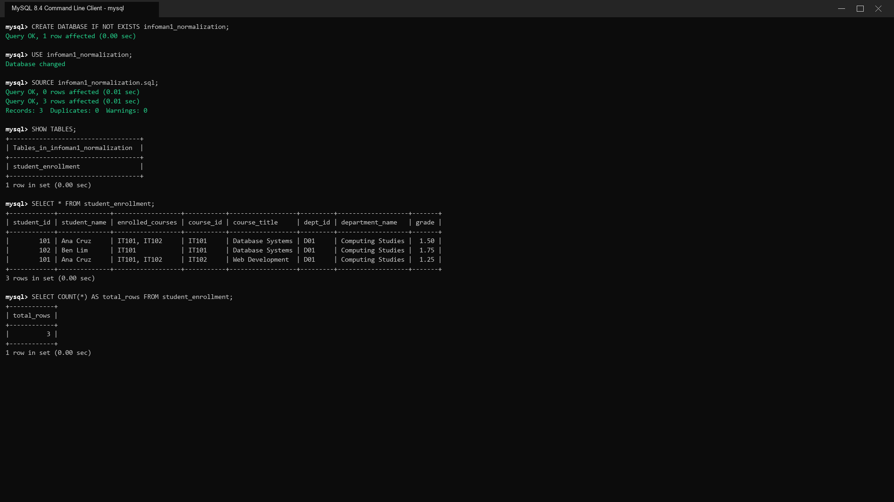
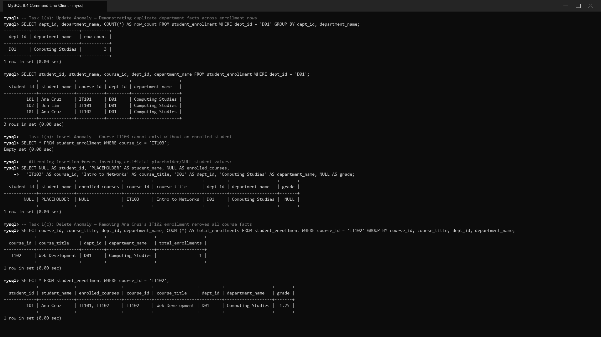
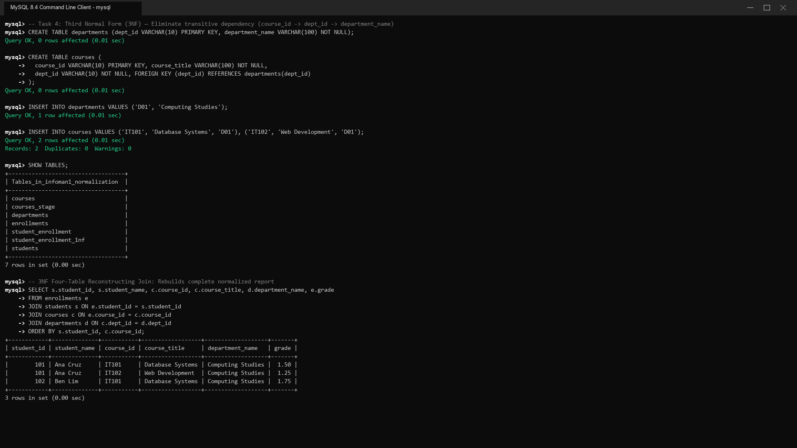

# INFOMAN1 — Week 11 Lab Answers

Name: Geoff Benedict Cariño  
Student ID: 2511028  
GitHub repo: https://github.com/geoxify/infoman1  
Date submitted: November 12, 2026  

---

**Database Setup Verification:**  
Database: `infoman1_normalization`  
Baseline Table: `student_enrollment`  



```text
mysql> CREATE DATABASE IF NOT EXISTS infoman1_normalization;
Query OK, 1 row affected (0.00 sec)

mysql> USE infoman1_normalization;
Database changed

mysql> SOURCE infoman1_normalization.sql;
Query OK, 0 rows affected (0.01 sec)
Query OK, 3 rows affected (0.01 sec)
Records: 3  Duplicates: 0  Warnings: 0

mysql> SHOW TABLES;
+-----------------------------------+
| Tables_in_infoman1_normalization  |
+-----------------------------------+
| student_enrollment                |
+-----------------------------------+
1 row in set (0.00 sec)

mysql> SELECT * FROM student_enrollment;
+------------+--------------+------------------+-----------+------------------+---------+-------------------+-------+
| student_id | student_name | enrolled_courses | course_id | course_title     | dept_id | department_name   | grade |
+------------+--------------+------------------+-----------+------------------+---------+-------------------+-------+
|        101 | Ana Cruz     | IT101, IT102     | IT101     | Database Systems | D01     | Computing Studies |  1.50 |
|        102 | Ben Lim      | IT101            | IT101     | Database Systems | D01     | Computing Studies |  1.75 |
|        101 | Ana Cruz     | IT101, IT102     | IT102     | Web Development  | D01     | Computing Studies |  1.25 |
+------------+--------------+------------------+-----------+------------------+---------+-------------------+-------+
3 rows in set (0.00 sec)

mysql> SELECT COUNT(*) AS total_rows FROM student_enrollment;
+------------+
| total_rows |
+------------+
|          3 |
+------------+
1 row in set (0.00 sec)
```

---

## Task 1 — Diagnose the Anomalies

**Approach / explanation:**  
To solve Task 1, I diagnosed the structural flaws of the denormalized `student_enrollment` table by executing targeted `SELECT` queries without modifying the underlying data. First, I quantified the update anomaly by grouping on `dept_id` and demonstrating that renaming department `D01` requires modifying three separate rows across different student records. Next, I demonstrated the insert anomaly by verifying that a new course (`IT103`) cannot be recorded without an enrolled student unless artificial dummy or NULL values are invented for student-related attributes. Finally, I demonstrated the delete anomaly by showing that deleting Ana Cruz's enrollment in `IT102` eradicates the only instance of `IT102` ('Web Development') from the entire database.

**Code / query used (if applicable):**
```sql
-- 1(a): Update Anomaly Demonstration
-- Shows how many rows carry department 'D01' and what a rename must touch.
SELECT dept_id, department_name, COUNT(*) AS row_count 
FROM student_enrollment 
WHERE dept_id = 'D01' 
GROUP BY dept_id, department_name;

SELECT student_id, student_name, course_id, dept_id, department_name 
FROM student_enrollment 
WHERE dept_id = 'D01';

-- 1(b): Insert Anomaly Demonstration
-- Verifies that new course IT103 cannot exist without an enrolled student.
SELECT * 
FROM student_enrollment 
WHERE course_id = 'IT103';

-- Hypothetical insertion forced to invent dummy/NULL values for student facts:
SELECT 
    NULL AS student_id, 
    'PLACEHOLDER' AS student_name, 
    NULL AS enrolled_courses,
    'IT103' AS course_id, 
    'Intro to Networks' AS course_title, 
    'D01' AS dept_id, 
    'Computing Studies' AS department_name, 
    NULL AS grade;

-- 1(c): Delete Anomaly Demonstration
-- Identifies which course facts vanish if Ana's IT102 enrollment row is removed.
SELECT course_id, course_title, dept_id, department_name, COUNT(*) AS total_enrollments 
FROM student_enrollment 
WHERE course_id = 'IT102' 
GROUP BY course_id, course_title, dept_id, department_name;

SELECT * 
FROM student_enrollment 
WHERE course_id = 'IT102';
```

**Evidence (screenshot filename, output, or file reference in this folder):**  


```text
mysql> -- Task 1(a): Update Anomaly — Demonstrating duplicate department facts across enrollment rows
mysql> SELECT dept_id, department_name, COUNT(*) AS row_count FROM student_enrollment WHERE dept_id = 'D01' GROUP BY dept_id, department_name;
+---------+-------------------+-----------+
| dept_id | department_name   | row_count |
+---------+-------------------+-----------+
| D01     | Computing Studies |         3 |
+---------+-------------------+-----------+
1 row in set (0.00 sec)

mysql> SELECT student_id, student_name, course_id, dept_id, department_name FROM student_enrollment WHERE dept_id = 'D01';
+------------+--------------+-----------+---------+-------------------+
| student_id | student_name | course_id | dept_id | department_name   |
+------------+--------------+-----------+---------+-------------------+
|        101 | Ana Cruz     | IT101     | D01     | Computing Studies |
|        102 | Ben Lim      | IT101     | D01     | Computing Studies |
|        101 | Ana Cruz     | IT102     | D01     | Computing Studies |
+------------+--------------+-----------+---------+-------------------+
3 rows in set (0.00 sec)

mysql> -- Task 1(b): Insert Anomaly — Course IT103 cannot exist without an enrolled student
mysql> SELECT * FROM student_enrollment WHERE course_id = 'IT103';
Empty set (0.00 sec)

mysql> -- Attempting insertion forces inventing artificial placeholder/NULL student values:
mysql> SELECT NULL AS student_id, 'PLACEHOLDER' AS student_name, NULL AS enrolled_courses,
    ->   'IT103' AS course_id, 'Intro to Networks' AS course_title, 'D01' AS dept_id, 'Computing Studies' AS department_name, NULL AS grade;
+------------+--------------+------------------+-----------+-------------------+---------+-------------------+-------+
| student_id | student_name | enrolled_courses | course_id | course_title      | dept_id | department_name   | grade |
+------------+--------------+------------------+-----------+-------------------+---------+-------------------+-------+
|       NULL | PLACEHOLDER  | NULL             | IT103     | Intro to Networks | D01     | Computing Studies |  NULL |
+------------+--------------+------------------+-----------+-------------------+---------+-------------------+-------+
1 row in set (0.00 sec)

mysql> -- Task 1(c): Delete Anomaly — Removing Ana Cruz's IT102 enrollment removes all course facts
mysql> SELECT course_id, course_title, dept_id, department_name, COUNT(*) AS total_enrollments FROM student_enrollment WHERE course_id = 'IT102' GROUP BY course_id, course_title, dept_id, department_name;
+-----------+-----------------+---------+-------------------+-------------------+
| course_id | course_title    | dept_id | department_name   | total_enrollments |
+-----------+-----------------+---------+-------------------+-------------------+
| IT102     | Web Development | D01     | Computing Studies |                 1 |
+-----------+-----------------+---------+-------------------+-------------------+
1 row in set (0.00 sec)

mysql> SELECT * FROM student_enrollment WHERE course_id = 'IT102';
+------------+--------------+------------------+-----------+-----------------+---------+-------------------+-------+
| student_id | student_name | enrolled_courses | course_id | course_title    | dept_id | department_name   | grade |
+------------+--------------+------------------+-----------+-----------------+---------+-------------------+-------+
|        101 | Ana Cruz     | IT101, IT102     | IT102     | Web Development | D01     | Computing Studies |  1.25 |
+------------+--------------+------------------+-----------+-----------------+---------+-------------------+-------+
1 row in set (0.00 sec)
```

**Structural Causes (One Sentence Per Anomaly):**
- **Update Anomaly:** The update anomaly is structurally caused by storing department attributes transitively inside student enrollment records, duplicating non-key department facts across multiple student-course rows.
- **Insert Anomaly:** The insert anomaly is structurally caused by mixing independent entities (courses and students) into an enrollment transaction table, preventing course creation without an active student enrollment.
- **Delete Anomaly:** The delete anomaly is structurally caused by coupling the existence of the master course entity to an ephemeral student enrollment record.

**Reflection question:**  
_Which of the three anomalies surprised you most in the seed table, and what single structural fact causes all three?_  
The delete anomaly surprised me most because dropping an individual student's course enrollment has the catastrophic side effect of wiping out the master course catalog record for `IT102` from the institution's knowledge base. All three anomalies stem from a single structural flaw: the table violates entity separation by conflating three distinct concepts—the `Student` entity, the `Course` entity, and the `Enrollment` relationship—into a single flat table.

---

## Task 2 — Reach First Normal Form

**Approach / explanation:**  
To reach First Normal Form (1NF), I eliminated the multi-valued attribute `enrolled_courses` by splitting composite course lists into discrete rows representing exactly one student-course enrollment. I defined a dependable row identity by assigning a composite primary key consisting of `(student_id, course_id)`. Then, I populated `student_enrollment_1nf` and executed both `DESCRIBE` and `SELECT` queries to prove that every cell now holds an atomic, indivisible scalar value.

**Code / query used (if applicable):**
```sql
CREATE TABLE student_enrollment_1nf (
  student_id INT NOT NULL,
  student_name VARCHAR(100) NOT NULL,
  course_id VARCHAR(10) NOT NULL,
  course_title VARCHAR(100) NOT NULL,
  dept_id VARCHAR(10) NOT NULL,
  department_name VARCHAR(100) NOT NULL,
  grade DECIMAL(4,2),
  PRIMARY KEY (student_id, course_id)
);

INSERT INTO student_enrollment_1nf VALUES
  (101, 'Ana Cruz', 'IT101', 'Database Systems', 'D01', 'Computing Studies', 1.50),
  (101, 'Ana Cruz', 'IT102', 'Web Development', 'D01', 'Computing Studies', 1.25),
  (102, 'Ben Lim', 'IT101', 'Database Systems', 'D01', 'Computing Studies', 1.75);

DESCRIBE student_enrollment_1nf;

SELECT student_id, student_name, course_id, course_title, dept_id, department_name, grade
FROM student_enrollment_1nf
ORDER BY student_id, course_id;
```

**Evidence (screenshot filename, output, or file reference in this folder):**  


```text
mysql> -- Task 2: First Normal Form (1NF) — Eliminate multi-valued cell and establish composite primary key
mysql> CREATE TABLE student_enrollment_1nf (
    ->   student_id INT NOT NULL,
    ->   student_name VARCHAR(100) NOT NULL,
    ->   course_id VARCHAR(10) NOT NULL,
    ->   course_title VARCHAR(100) NOT NULL,
    ->   dept_id VARCHAR(10) NOT NULL,
    ->   department_name VARCHAR(100) NOT NULL,
    ->   grade DECIMAL(4,2),
    ->   PRIMARY KEY (student_id, course_id)
    -> );
Query OK, 0 rows affected (0.01 sec)

mysql> INSERT INTO student_enrollment_1nf VALUES
    ->   (101, 'Ana Cruz', 'IT101', 'Database Systems', 'D01', 'Computing Studies', 1.50),
    ->   (101, 'Ana Cruz', 'IT102', 'Web Development', 'D01', 'Computing Studies', 1.25),
    ->   (102, 'Ben Lim', 'IT101', 'Database Systems', 'D01', 'Computing Studies', 1.75);
Query OK, 3 rows affected (0.01 sec)
Records: 3  Duplicates: 0  Warnings: 0

mysql> DESCRIBE student_enrollment_1nf;
+-----------------+--------------+------+-----+---------+-------+
| Field           | Type         | Null | Key | Default | Extra |
+-----------------+--------------+------+-----+---------+-------+
| student_id      | int          | NO   | PRI | NULL    |       |
| student_name    | varchar(100) | NO   |     | NULL    |       |
| course_id       | varchar(10)  | NO   | PRI | NULL    |       |
| course_title    | varchar(100) | NO   |     | NULL    |       |
| dept_id         | varchar(10)  | NO   |     | NULL    |       |
| department_name | varchar(100) | NO   |     | NULL    |       |
| grade           | decimal(4,2) | YES  |     | NULL    |       |
+-----------------+--------------+------+-----+---------+-------+
7 rows in set (0.00 sec)

mysql> -- Atomic cell verification: Each cell holds exactly one indivisible scalar value
mysql> SELECT student_id, student_name, course_id, course_title, dept_id, department_name, grade
    -> FROM student_enrollment_1nf
    -> ORDER BY student_id, course_id;
+------------+--------------+-----------+------------------+---------+-------------------+-------+
| student_id | student_name | course_id | course_title     | dept_id | department_name   | grade |
+------------+--------------+-----------+------------------+---------+-------------------+-------+
|        101 | Ana Cruz     | IT101     | Database Systems | D01     | Computing Studies |  1.50 |
|        101 | Ana Cruz     | IT102     | Web Development  | D01     | Computing Studies |  1.25 |
|        102 | Ben Lim      | IT101     | Database Systems | D01     | Computing Studies |  1.75 |
+------------+--------------+-----------+------------------+---------+-------------------+-------+
3 rows in set (0.00 sec)
```

**Leftover Redundancy in 1NF:**  
1NF requires only atomicity of attribute values and unique row identification. It deliberately leaves behind functional dependency redundancies:
1. **Partial Dependency Redundancy:** `student_name` is duplicated across multiple rows whenever a student enrolls in more than one course (e.g., 'Ana Cruz' appears twice). Similarly, `course_title`, `dept_id`, and `department_name` repeat across multiple rows whenever several students take the same course (e.g., 'Database Systems' appears twice for `IT101`).
2. **Transitive Dependency Redundancy:** `department_name` is duplicated as a function of `dept_id` independently of students.

**Reflection question:**  
_Why does splitting the multi-valued cell still leave student names repeating, and which normal form removes that next?_  
Splitting the multi-valued cell expands each student-course pair into its own physical row, so a student taking $N$ courses generates $N$ rows containing their repeated name. This repetition occurs because `student_name` functionally depends on only a subset of the composite primary key (`student_id` $\to$ `student_name`), which represents a partial functional dependency. Second Normal Form (2NF) removes this partial dependency next by splitting student facts into a dedicated `students` relation.

---

## Task 3 — Reach Second Normal Form

**Approach / explanation:**  
To reach Second Normal Form (2NF), I first analyzed the functional dependencies of the 1NF table against the composite primary key `{student_id, course_id}`. I identified that `student_name` depends solely on `student_id`, while `course_title`, `dept_id`, and `department_name` depend solely on `course_id`. I eliminated these partial dependencies by performing a key-preserving decomposition into three tables: `students`, `courses_stage`, and `enrollments`. Finally, I executed a 3-table `JOIN` query to prove that the original wide report reconstructs losslessly.

**Functional Dependencies Observed:**
1. `student_id -> student_name` *(Partial Dependency on part of the composite key `student_id`)*
2. `course_id -> course_title, dept_id, department_name` *(Partial Dependency on part of the composite key `course_id`)*
3. `dept_id -> department_name` *(Transitive Dependency via `course_id`, to be resolved in 3NF)*
4. `{student_id, course_id} -> grade` *(Full Functional Dependency on the complete composite key)*

**Code / query used (if applicable):**
```sql
CREATE TABLE students (
  student_id INT PRIMARY KEY,
  student_name VARCHAR(100) NOT NULL
);

CREATE TABLE courses_stage (
  course_id VARCHAR(10) PRIMARY KEY,
  course_title VARCHAR(100) NOT NULL,
  dept_id VARCHAR(10) NOT NULL,
  department_name VARCHAR(100) NOT NULL
);

CREATE TABLE enrollments (
  student_id INT NOT NULL,
  course_id VARCHAR(10) NOT NULL,
  grade DECIMAL(4,2),
  PRIMARY KEY (student_id, course_id),
  FOREIGN KEY (student_id) REFERENCES students(student_id),
  FOREIGN KEY (course_id) REFERENCES courses_stage(course_id)
);

INSERT INTO students VALUES (101, 'Ana Cruz'), (102, 'Ben Lim');

INSERT INTO courses_stage VALUES
  ('IT101', 'Database Systems', 'D01', 'Computing Studies'),
  ('IT102', 'Web Development', 'D01', 'Computing Studies');

INSERT INTO enrollments VALUES
  (101, 'IT101', 1.50),
  (101, 'IT102', 1.25),
  (102, 'IT101', 1.75);

-- 2NF Reconstructing Join:
SELECT 
    s.student_id,
    s.student_name,
    c.course_id,
    c.course_title,
    c.dept_id,
    c.department_name,
    e.grade
FROM enrollments e
JOIN students s ON e.student_id = s.student_id
JOIN courses_stage c ON e.course_id = c.course_id
ORDER BY s.student_id, c.course_id;
```

**Justification for `grade` Placement (One Sentence):**  
The attribute `grade` must remain with the full composite key `(student_id, course_id)` because a grade is meaningful only for a specific student enrolled in a specific course—it cannot be determined by the student alone or by the course alone.

**Evidence (screenshot filename, output, or file reference in this folder):**  


```text
mysql> -- Task 3: Second Normal Form (2NF) — Eliminate partial functional dependencies
mysql> CREATE TABLE students (student_id INT PRIMARY KEY, student_name VARCHAR(100) NOT NULL);
Query OK, 0 rows affected (0.01 sec)

mysql> CREATE TABLE courses_stage (
    ->   course_id VARCHAR(10) PRIMARY KEY, course_title VARCHAR(100) NOT NULL,
    ->   dept_id VARCHAR(10) NOT NULL, department_name VARCHAR(100) NOT NULL
    -> );
Query OK, 0 rows affected (0.01 sec)

mysql> CREATE TABLE enrollments (
    ->   student_id INT NOT NULL, course_id VARCHAR(10) NOT NULL, grade DECIMAL(4,2),
    ->   PRIMARY KEY (student_id, course_id),
    ->   FOREIGN KEY (student_id) REFERENCES students(student_id),
    ->   FOREIGN KEY (course_id) REFERENCES courses_stage(course_id)
    -> );
Query OK, 0 rows affected (0.01 sec)

mysql> INSERT INTO students VALUES (101, 'Ana Cruz'), (102, 'Ben Lim');
Query OK, 2 rows affected (0.01 sec)
Records: 2  Duplicates: 0  Warnings: 0

mysql> INSERT INTO courses_stage VALUES
    ->   ('IT101', 'Database Systems', 'D01', 'Computing Studies'),
    ->   ('IT102', 'Web Development', 'D01', 'Computing Studies');
Query OK, 2 rows affected (0.01 sec)
Records: 2  Duplicates: 0  Warnings: 0

mysql> INSERT INTO enrollments VALUES
    ->   (101, 'IT101', 1.50), (101, 'IT102', 1.25), (102, 'IT101', 1.75);
Query OK, 3 rows affected (0.01 sec)
Records: 3  Duplicates: 0  Warnings: 0

mysql> -- 2NF Reconstructing Join: Lossless join reconstructing original wide report
mysql> SELECT s.student_id, s.student_name, c.course_id, c.course_title, c.dept_id, c.department_name, e.grade
    -> FROM enrollments e
    -> JOIN students s ON e.student_id = s.student_id
    -> JOIN courses_stage c ON e.course_id = c.course_id
    -> ORDER BY s.student_id, c.course_id;
+------------+--------------+-----------+------------------+---------+-------------------+-------+
| student_id | student_name | course_id | course_title     | dept_id | department_name   | grade |
+------------+--------------+-----------+------------------+---------+-------------------+-------+
|        101 | Ana Cruz     | IT101     | Database Systems | D01     | Computing Studies |  1.50 |
|        101 | Ana Cruz     | IT102     | Web Development  | D01     | Computing Studies |  1.25 |
|        102 | Ben Lim      | IT101     | Database Systems | D01     | Computing Studies |  1.75 |
+------------+--------------+-----------+------------------+---------+-------------------+-------+
3 rows in set (0.00 sec)
```

**Reflection question:**  
_How do you tell that student name depends on part of the key while grade depends on the whole key?_  
You determine this by testing if an attribute's value is uniquely fixed by a proper subset of the composite candidate key `{student_id, course_id}`. `student_name` is determined solely by `student_id` because Ana Cruz's name remains constant regardless of what course is paired with her identifier. In contrast, `grade` cannot be resolved knowing only `student_id` (Ana has grades of 1.50 in IT101 and 1.25 in IT102) nor knowing only `course_id` (IT101 has grades of 1.50 and 1.75 across different students), meaning `grade` is strictly fully functionally dependent on the entire composite key.

---

## Task 4 — Reach Third Normal Form

**Approach / explanation:**  
To reach Third Normal Form (3NF), I identified and resolved the transitive dependency in `courses_stage`, where `course_id` functionally determines `dept_id`, which in turn functionally determines `department_name` (`course_id` $\to$ `dept_id` $\to$ `department_name`). I isolated department facts by creating `departments(dept_id, department_name)` and reduced `courses` to `(course_id, course_title, dept_id)` with a foreign key constraint linking to `departments`. I then evaluated the normalization decision path for each final table and verified schema integrity using a four-table `JOIN` reconstructing student name, course title, department name, and grade.

**Transitive Dependency Chain:**  
`course_id -> dept_id -> department_name`  
Here, non-prime attribute `dept_id` functionally determines non-prime attribute `department_name`.

**Normalization Decision Path Verdict per Table:**
1. **`departments` (`dept_id`, `department_name`)**
   - Multi-valued attributes? No $\to$ **1NF Valid**
   - Partial dependencies? No (single-attribute PK `dept_id`) $\to$ **2NF Valid**
   - Transitive dependencies? No (`department_name` directly depends on PK) $\to$ **3NF Valid**
   - **Verdict:** **In 3NF**
2. **`courses` (`course_id`, `course_title`, `dept_id`)**
   - Multi-valued attributes? No $\to$ **1NF Valid**
   - Partial dependencies? No (single-attribute PK `course_id`) $\to$ **2NF Valid**
   - Transitive dependencies? No (non-key attributes depend directly on `course_id`; no non-key to non-key dependencies) $\to$ **3NF Valid**
   - **Verdict:** **In 3NF**
3. **`students` (`student_id`, `student_name`)**
   - Multi-valued attributes? No $\to$ **1NF Valid**
   - Partial dependencies? No (single-attribute PK `student_id`) $\to$ **2NF Valid**
   - Transitive dependencies? No (`student_name` depends directly on PK) $\to$ **3NF Valid**
   - **Verdict:** **In 3NF**
4. **`enrollments` (`student_id`, `course_id`, `grade`)**
   - Multi-valued attributes? No $\to$ **1NF Valid**
   - Partial dependencies? No (`grade` requires full composite PK `{student_id, course_id}`) $\to$ **2NF Valid**
   - Transitive dependencies? No (only one non-key attribute, `grade`, directly dependent on PK) $\to$ **3NF Valid**
   - **Verdict:** **In 3NF**

**Code / query used (if applicable):**
```sql
CREATE TABLE departments (
  dept_id VARCHAR(10) PRIMARY KEY,
  department_name VARCHAR(100) NOT NULL
);

CREATE TABLE courses (
  course_id VARCHAR(10) PRIMARY KEY,
  course_title VARCHAR(100) NOT NULL,
  dept_id VARCHAR(10) NOT NULL,
  FOREIGN KEY (dept_id) REFERENCES departments(dept_id)
);

INSERT INTO departments VALUES ('D01', 'Computing Studies');

INSERT INTO courses VALUES 
  ('IT101', 'Database Systems', 'D01'), 
  ('IT102', 'Web Development', 'D01');

-- Final 3NF Four-Table Reconstructing Join:
SELECT 
    s.student_id,
    s.student_name,
    c.course_id,
    c.course_title,
    d.department_name,
    e.grade
FROM enrollments e
JOIN students s ON e.student_id = s.student_id
JOIN courses c ON e.course_id = c.course_id
JOIN departments d ON c.dept_id = d.dept_id
ORDER BY s.student_id, c.course_id;
```

**Evidence (screenshot filename, output, or file reference in this folder):**  


```text
mysql> -- Task 4: Third Normal Form (3NF) — Eliminate transitive dependency (course_id -> dept_id -> department_name)
mysql> CREATE TABLE departments (dept_id VARCHAR(10) PRIMARY KEY, department_name VARCHAR(100) NOT NULL);
Query OK, 0 rows affected (0.01 sec)

mysql> CREATE TABLE courses (
    ->   course_id VARCHAR(10) PRIMARY KEY, course_title VARCHAR(100) NOT NULL,
    ->   dept_id VARCHAR(10) NOT NULL, FOREIGN KEY (dept_id) REFERENCES departments(dept_id)
    -> );
Query OK, 0 rows affected (0.01 sec)

mysql> INSERT INTO departments VALUES ('D01', 'Computing Studies');
Query OK, 1 row affected (0.01 sec)

mysql> INSERT INTO courses VALUES ('IT101', 'Database Systems', 'D01'), ('IT102', 'Web Development', 'D01');
Query OK, 2 rows affected (0.01 sec)
Records: 2  Duplicates: 0  Warnings: 0

mysql> SHOW TABLES;
+-----------------------------------+
| Tables_in_infoman1_normalization  |
+-----------------------------------+
| courses                           |
| courses_stage                     |
| departments                       |
| enrollments                       |
| student_enrollment                |
| student_enrollment_1nf            |
| students                          |
+-----------------------------------+
7 rows in set (0.00 sec)

mysql> -- 3NF Four-Table Reconstructing Join: Rebuilds complete normalized report
mysql> SELECT s.student_id, s.student_name, c.course_id, c.course_title, d.department_name, e.grade
    -> FROM enrollments e
    -> JOIN students s ON e.student_id = s.student_id
    -> JOIN courses c ON e.course_id = c.course_id
    -> JOIN departments d ON c.dept_id = d.dept_id
    -> ORDER BY s.student_id, c.course_id;
+------------+--------------+-----------+------------------+-------------------+-------+
| student_id | student_name | course_id | course_title     | department_name   | grade |
+------------+--------------+-----------+------------------+-------------------+-------+
|        101 | Ana Cruz     | IT101     | Database Systems | Computing Studies |  1.50 |
|        101 | Ana Cruz     | IT102     | Web Development  | Computing Studies |  1.25 |
|        102 | Ben Lim      | IT101     | Database Systems | Computing Studies |  1.75 |
+------------+--------------+-----------+------------------+-------------------+-------+
3 rows in set (0.00 sec)
```

**Reflection question:**  
_What makes the department name indirectly dependent, and how does the final four-table join prove nothing was lost?_  
`department_name` is indirectly dependent because its relationship to the primary key `course_id` is mediated entirely through `dept_id`; a course belongs to a department, and the department has a name. The final four-table join proves nothing was lost because every original column tuple `(student_name, course_title, department_name, grade)` is reconstructed exactly with identical cardinalities and attribute relationships, verifying that the decomposition satisfies the lossless-join property without producing spurious tuples.

---

## Task 5 — Reflection

**Approach / explanation:**  
To solve Task 5, I synthesized the practical trade-offs between normalized OLTP schemas and denormalized reporting architectures in enterprise campus database systems. I evaluated how 3NF prevents operational write anomalies while considering scenarios where controlled denormalization preserves historical data integrity. Finally, I analyzed common normalization pitfalls, identifying the symptoms and corrective measures associated with dropped keys during decomposition.

**Code / query used (if applicable):**
```sql
-- Illustrative example of maintaining schema integrity in 3NF decomposition:
-- Preserving composite primary key and foreign key references in junction table
CREATE TABLE enrollments (
  student_id INT NOT NULL,
  course_id VARCHAR(10) NOT NULL,
  grade DECIMAL(4,2),
  PRIMARY KEY (student_id, course_id),
  FOREIGN KEY (student_id) REFERENCES students(student_id),
  FOREIGN KEY (course_id) REFERENCES courses(course_id)
);
```

**Evidence (screenshot filename, output, or file reference in this folder):**  
_Reflection Essay (179 words):_

In a campus enrollment system, 3NF is essential for operational transaction processing (OLTP) tables—such as `students`, `courses`, and `enrollments`—to eliminate update, insert, and delete anomalies. For example, isolating `department_name` into a `departments` table ensures an academic department rename requires updating only one row rather than thousands of enrollment records. Conversely, deliberate denormalization is preferred for read-heavy reporting or historical audit snapshots, such as caching `department_name` or `course_title` directly on student term transcripts so historical records remain immutable even if a department or course is subsequently renamed or restructured.

A common mistake I observed was dropping a candidate key during a decomposition split. Specifically, when decomposing `student_enrollment_1nf` into 2NF, one might initially split out `courses` and `students` but forget to include both `student_id` and `course_id` as foreign keys forming the composite primary key in the bridging `enrollments` table. The immediate symptom was a lossy decomposition where student grades could not be associated with their corresponding courses, producing Cartesian product duplicates upon reconstruction. I resolved this by enforcing `PRIMARY KEY (student_id, course_id)` with explicit foreign key constraints referencing the parent tables.

**Reflection question:**  
_When would you keep some denormalized repetition on purpose, and what single symptom tells you a split dropped a key?_  
Denormalized repetition is deliberately preserved when creating point-in-time historical audit snapshots (such as official student transcripts, billing invoices, or archived grading rosters) so that future changes to master catalog names do not retroactively alter historic records, as well as in analytical data warehouses to optimize query throughput by avoiding expensive multi-table joins. The single definitive symptom that a split dropped a key is a lossy join upon query reconstruction, characterized by spurious duplicate rows (Cartesian product expansion) or an inability to reconnect non-key facts to their originating entities.

---

## Self-Check

- [x] All tasks committed with individual, meaningful commit messages
- [x] All files placed inside `week11/`
- [x] This file completed and renamed `answers.md`
- [x] Repository link pasted into Moodle (no files uploaded)
