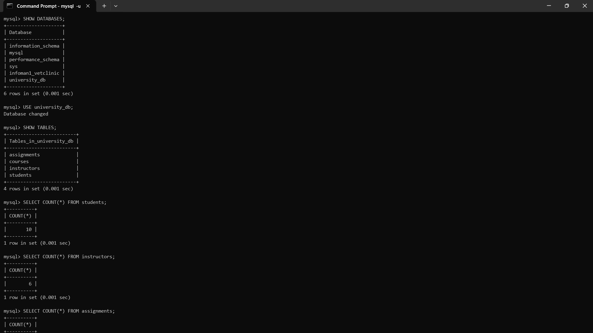
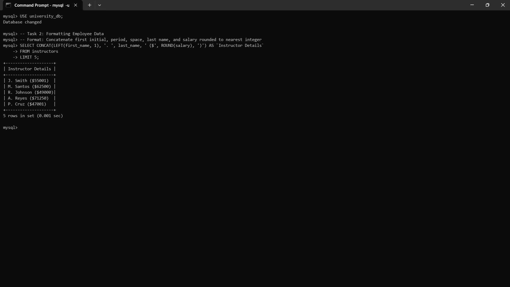
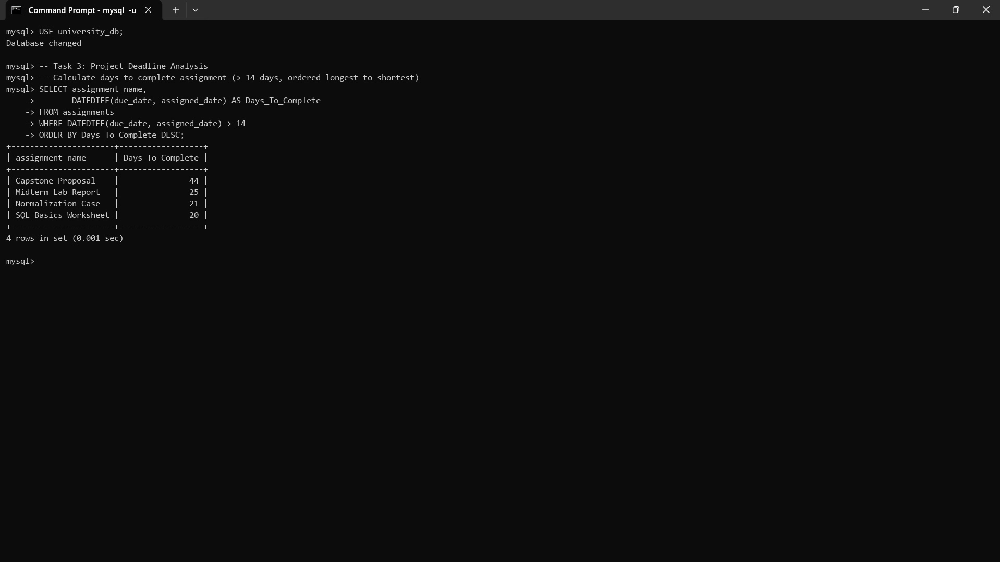
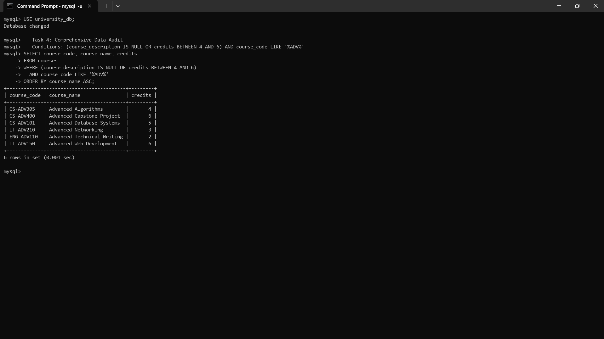

# INFOMAN1 — Week 7 Lab Answers

**Student Name:** Geoff Benedict Cariño  
**Student ID:** 2511028  
**Course & Section:** Information Management 1 (INFOMAN1) — Midterm, Week 7  
**Database Name:** university_db  
**Repository:** [https://github.com/geoxify/infoman1](https://github.com/geoxify/infoman1)  

---

## Lab Overview & Database Setup

This laboratory exercise reinforces advanced Data Query Language (DQL) techniques in MySQL, focusing on compound logical filtering (`AND`, `OR`, `NOT`), set and pattern evaluation (`IN`, `LIKE`, `BETWEEN`, `IS NULL`), scalar text, numeric, and date manipulation functions (`CONCAT`, `LEFT`, `ROUND`, `DATEDIFF`), and query result presentation using column aliases and sorting (`ORDER BY`, `LIMIT`).

The queries operate on the `university_db` database, which models students, instructors, coursework assignments, and course catalogs:

```sql
SHOW DATABASES;
USE university_db;
SHOW TABLES;
SELECT COUNT(*) FROM students;     -- 10 rows
SELECT COUNT(*) FROM instructors;  -- 6 rows
SELECT COUNT(*) FROM assignments;  -- 6 rows
SELECT COUNT(*) FROM courses;      -- 8 rows
```



---

## Task 1 — Complex Student Roster

**Approach / explanation:**
To solve this task, I queried the `students` table and applied compound filtering predicates in the `WHERE` clause using logical `AND` operators. First, I utilized the `IN` set-membership operator to filter for students majoring in either `'Computer Science'` or `'Information Technology'`. Second, I applied the pattern-matching `LIKE 'S%'` predicate to identify students whose last name starts with the letter 'S'. Finally, I incorporated the logical negation operator via `NOT section = 'Online'` to explicitly exclude any students enrolled in online sections. Exactly 5 student records satisfied all three conditions simultaneously.

**Code / query used (if applicable):**
```sql
SELECT first_name, last_name, major
FROM students
WHERE major IN ('Computer Science', 'Information Technology')
  AND last_name LIKE 'S%'
  AND NOT section = 'Online';
```

**Evidence (screenshot filename, output, or file reference in this folder):**


```text
mysql> SELECT first_name, last_name, major
    -> FROM students
    -> WHERE major IN ('Computer Science', 'Information Technology')
    ->   AND last_name LIKE 'S%'
    ->   AND NOT section = 'Online';
+------------+-----------+------------------------+
| first_name | last_name | major                  |
+------------+-----------+------------------------+
| Sofia      | Santos    | Computer Science       |
| Samuel     | Santiago  | Information Technology |
| Sarah      | Sy        | Computer Science       |
| Daniel     | Serrano   | Information Technology |
| Liza       | Soberano  | Computer Science       |
+------------+-----------+------------------------+
5 rows in set (0.001 sec)
```

**Reflection question:**
Why is it often better to use the `IN` operator rather than chaining multiple `OR` conditions when filtering by a specific list of values?

1. **Syntactic Conciseness and Code Maintainability:** The `IN` operator enables developers to test a column against a discrete collection of scalar values in a compact, readable syntax (e.g., `major IN ('Computer Science', 'Information Technology')`). In contrast, chaining `OR` requires repeating the attribute name for each comparison (`major = 'Computer Science' OR major = 'Information Technology'`). With larger value sets, `IN` eliminates repetitive boilerplate code, reduces human syntax error, and makes adding or removing elements trivial.
2. **Elimination of Operator Precedence Ambiguity:** In SQL boolean logic, `AND` takes precedence over `OR`. When multiple `OR` conditions are chained alongside `AND` filters without rigorous parenthesization, subtle logic bugs frequently emerge. The `IN` operator encapsulates the discrete value list into a single self-contained atomic predicate, avoiding precedence conflicts with surrounding `AND` operators.
3. **Internal Query Optimization:** MySQL's query execution engine optimizes `IN` lists composed of constants by sorting the values and using an efficient binary search or in-memory hash lookup ($O(\log n)$ or $O(1)$) during tuple evaluation. Chained `OR` conditions, by contrast, are evaluated sequentially from left to right ($O(n)$). When applied to indexed columns, `IN` predicates can also leverage range scans and index dive optimizations much more effectively.

---

## Task 2 — Formatting Employee Data

**Approach / explanation:**
I applied built-in string and numeric scalar functions within the `SELECT` projection against the `instructors` table to transform raw employee data into a standardized presentation format. Using `LEFT(first_name, 1)` (or `SUBSTRING(first_name, 1, 1)`), I extracted the instructor's first initial, and used `ROUND(salary)` to round fractional monetary compensation to the nearest integer. These components were assembled with literal punctuation and parentheses using `CONCAT()` into the pattern `"Initial. LastName ($Salary)"`, assigned the column alias `` `Instructor Details` ``, and constrained to the first five rows using `LIMIT 5`.

**Code / query used (if applicable):**
```sql
SELECT CONCAT(LEFT(first_name, 1), '. ', last_name, ' ($', ROUND(salary), ')') AS `Instructor Details`
FROM instructors
LIMIT 5;
```

**Evidence (screenshot filename, output, or file reference in this folder):**


```text
mysql> SELECT CONCAT(LEFT(first_name, 1), '. ', last_name, ' ($', ROUND(salary), ')') AS `Instructor Details`
    -> FROM instructors
    -> LIMIT 5;
+--------------------+
| Instructor Details |
+--------------------+
| J. Smith ($55001)  |
| M. Santos ($62500) |
| R. Johnson ($49000)|
| A. Reyes ($71250)  |
| P. Cruz ($47001)   |
+--------------------+
5 rows in set (0.001 sec)
```

**Reflection question:**
How do string functions like `CONCAT` affect the performance of a query compared to retrieving raw columns and formatting them in the application layer (e.g., in Java or Python)?

1. **Database Server CPU & Resource Contention:** Relational database engines are optimized and provisioned for data storage, index searching, join resolution, and disk/buffer-pool I/O throughput. Executing row-by-row string parsing, concatenation, and scalar arithmetic forces the DBMS CPU to perform computational presentation work across every candidate row. Under high concurrency, offloading string formatting onto the central database can quickly exhaust database worker threads and CPU capacity.
2. **Architectural Separation of Concerns & Localization:** Retrieving raw, unadorned atomic data preserves clean separation between the database tier and the application/presentation tiers. When raw values (e.g., raw numeric salaries or independent first and last name fields) are transmitted to application services (in Spring Boot, Python, or TypeScript), the presentation layer can dynamically apply localized currency formats (`$`, `₱`, `€`), regional name conventions, or responsive layouts without requiring changes to database queries or breaking database cache entries.
3. **Index Usability and Network Serialization:** While scalar functions applied in the `SELECT` projection do not invalidate index lookups in the destructive manner that non-SARGable functions do when placed in `WHERE` clauses, assembling dynamic strings increases temporary buffer allocations in MySQL memory prior to socket transmission. Modern distributed architectures generally favor transmitting lean, structured raw payloads and delegating UI formatting to horizontally scalable application workers.

---

## Task 3 — Project Deadline Analysis

**Approach / explanation:**
To calculate the total duration available to students for each assignment, I used MySQL's built-in date difference function `DATEDIFF(due_date, assigned_date)`, which calculates the signed integer difference in days between two date expressions. I aliased the resulting calculation as `Days_To_Complete`. Because standard SQL execution order evaluates the `WHERE` clause prior to projection aliasing in the `SELECT` clause, I filtered records using `WHERE DATEDIFF(due_date, assigned_date) > 14`, and then sorted the resulting assignments from longest duration to shortest using `ORDER BY Days_To_Complete DESC`. Four assignments met the threshold.

**Code / query used (if applicable):**
```sql
SELECT assignment_name,
       DATEDIFF(due_date, assigned_date) AS Days_To_Complete
FROM assignments
WHERE DATEDIFF(due_date, assigned_date) > 14
ORDER BY Days_To_Complete DESC;
```

**Evidence (screenshot filename, output, or file reference in this folder):**


```text
mysql> SELECT assignment_name,
    ->        DATEDIFF(due_date, assigned_date) AS Days_To_Complete
    -> FROM assignments
    -> WHERE DATEDIFF(due_date, assigned_date) > 14
    -> ORDER BY Days_To_Complete DESC;
+----------------------+------------------+
| assignment_name      | Days_To_Complete |
+----------------------+------------------+
| Capstone Proposal    |               44 |
| Midterm Lab Report   |               25 |
| Normalization Case   |               21 |
| SQL Basics Worksheet |               20 |
+----------------------+------------------+
4 rows in set (0.001 sec)
```

**Reflection question:**
Why is column aliasing particularly important when using mathematical or date functions in the `SELECT` clause?

1. **Semantic Clarity and Result-Set Readability:** When a computed function or mathematical expression (such as `DATEDIFF(due_date, assigned_date)`) is projected without an alias, MySQL labels the resulting column header with the exact raw expression string. In console grids, visual reports, and business dashboards, this produces cluttered, awkward headers. Supplying an alias like `Days_To_Complete` provides immediate semantic context for end users.
2. **Programmatic Data Access (API & ORM Binding):** Backend frameworks and database drivers (JDBC, ODBC, Python DB-API, Prisma, Hibernate) map returned result rows into key-value maps, dictionaries, or data transfer objects (DTOs) using the column headers as object keys. Referencing `row['Days_To_Complete']` in application code is clean, stable, and language-idiomatic, whereas referencing `row['DATEDIFF(due_date, assigned_date)']` is error-prone, fragile, and tightly couples application code to specific SQL function syntax.
3. **Downstream SQL Clause Reusability:** Under ANSI SQL execution lifecycle order (`FROM` $\rightarrow$ `WHERE` $\rightarrow$ `GROUP BY` $\rightarrow$ `HAVING` $\rightarrow$ `SELECT` $\rightarrow$ `ORDER BY` $\rightarrow$ `LIMIT`), aliases defined in the `SELECT` clause become accessible to subsequent query phases. In our query, `ORDER BY Days_To_Complete DESC` references the alias directly, avoiding the need to redundantly repeat the `DATEDIFF` computation in the sorting phase.

---

## Task 4 — Comprehensive Data Audit

**Approach / explanation:**
To perform the audit on the `courses` catalog, I authored a single query combining relational filtering, NULL detection, numeric range boundaries, pattern matching, and explicit operator precedence. I utilized `course_description IS NULL` to identify unpopulated descriptions, `credits BETWEEN 4 AND 6` to filter for mid-to-high credit courses, and `course_code LIKE '%ADV%'` to ensure only advanced courses were selected. To guarantee that the disjunctive condition was evaluated as a single logical unit before being combined with the mandatory course code requirement, I enclosed the `OR` expression within parentheses `(course_description IS NULL OR credits BETWEEN 4 AND 6)`, ordering the resulting 6 audit matches alphabetically using `ORDER BY course_name ASC`.

**Code / query used (if applicable):**
```sql
SELECT course_code, course_name, credits
FROM courses
WHERE (course_description IS NULL OR credits BETWEEN 4 AND 6)
  AND course_code LIKE '%ADV%'
ORDER BY course_name ASC;
```

**Evidence (screenshot filename, output, or file reference in this folder):**


```text
mysql> SELECT course_code, course_name, credits
    -> FROM courses
    -> WHERE (course_description IS NULL OR credits BETWEEN 4 AND 6)
    ->   AND course_code LIKE '%ADV%'
    -> ORDER BY course_name ASC;
+-------------+----------------------------+---------+
| course_code | course_name                | credits |
+-------------+----------------------------+---------+
| CS-ADV305   | Advanced Algorithms        |       4 |
| CS-ADV400   | Advanced Capstone Project  |       6 |
| CS-ADV101   | Advanced Database Systems  |       5 |
| IT-ADV210   | Advanced Networking        |       3 |
| ENG-ADV110  | Advanced Technical Writing |       2 |
| IT-ADV150   | Advanced Web Development   |       6 |
+-------------+----------------------------+---------+
6 rows in set (0.001 sec)
```

**Reflection question:**
Explain how MySQL evaluates the expression `A OR B AND C`. How did you use parentheses (if you did) to ensure your query filtered the exact data requested in the instructions?

1. **Operator Precedence in SQL:** In standard ANSI SQL and MySQL execution logic, the logical operator `AND` holds a higher precedence than the logical operator `OR` (analogous to multiplication taking precedence over addition in arithmetic operations).
2. **Default Evaluation of `A OR B AND C`:** When MySQL parses an unparenthesized expression written as `A OR B AND C`, it binds `B AND C` together first, evaluating the entire expression as:
   $$\text{Result} = A \lor (B \land C)$$
3. **Application to the Course Audit Breakdown:**
   - Let $A$ = `course_description IS NULL`
   - Let $B$ = `credits BETWEEN 4 AND 6`
   - Let $C$ = `course_code LIKE '%ADV%'`
   - Without parentheses (`WHERE A OR B AND C`), MySQL evaluates:
     `WHERE course_description IS NULL OR (credits BETWEEN 4 AND 6 AND course_code LIKE '%ADV%')`
   - Under this default precedence, any course with a missing description ($A$ is `TRUE`) would be returned **regardless** of whether its course code contains `'ADV'` ($C$). For example, `CS-101 Introduction to Computing` (which has 3 credits, a NULL description, and code `'CS-101'`) would be incorrectly included in the results simply because $A$ evaluates to `TRUE`.
4. **Parenthetical Enforcement:** By placing parentheses around the disjunction `(course_description IS NULL OR credits BETWEEN 4 AND 6)`, I explicitly overrode default operator precedence:
   $$\text{Enforced Logic} = (A \lor B) \land C$$
   This ensures that the choice between a missing description or 4–6 credits is evaluated first, and only records that also satisfy the advanced course code filter ($C$) are returned, producing an exact, audit-compliant result set.

---

## Self-Check

- [x] All tasks committed with individual, meaningful commit messages
- [x] All files placed inside `week7/`
- [x] This file completed and renamed `answers.md`
- [x] Repository link pasted into Moodle (no files uploaded)
