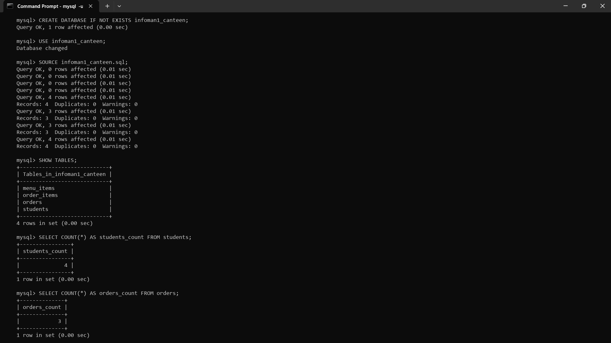
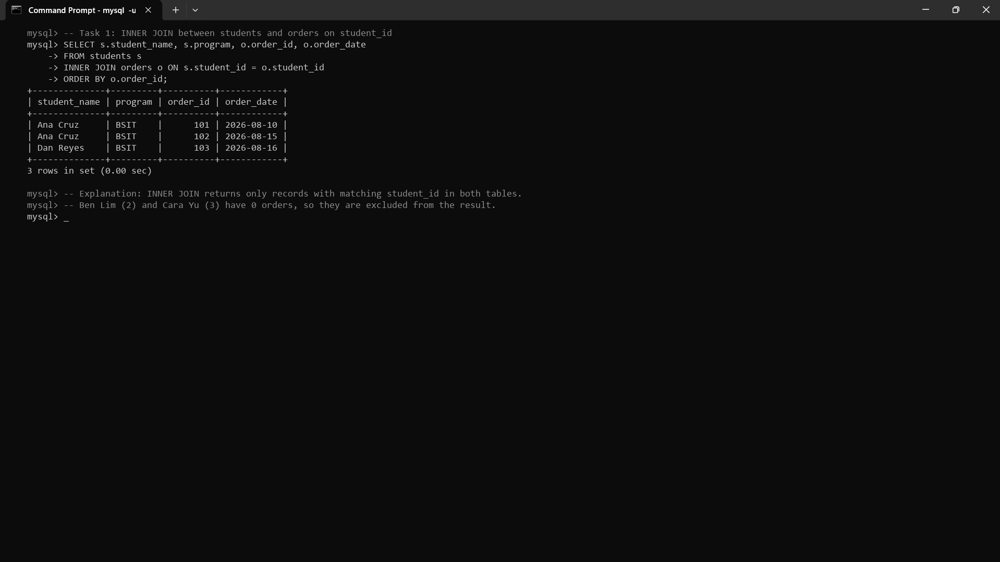
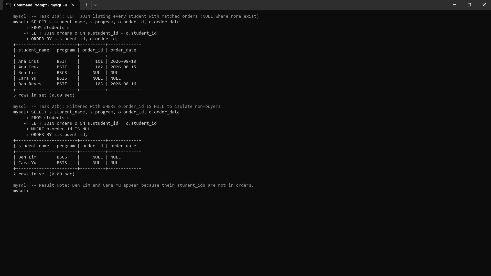
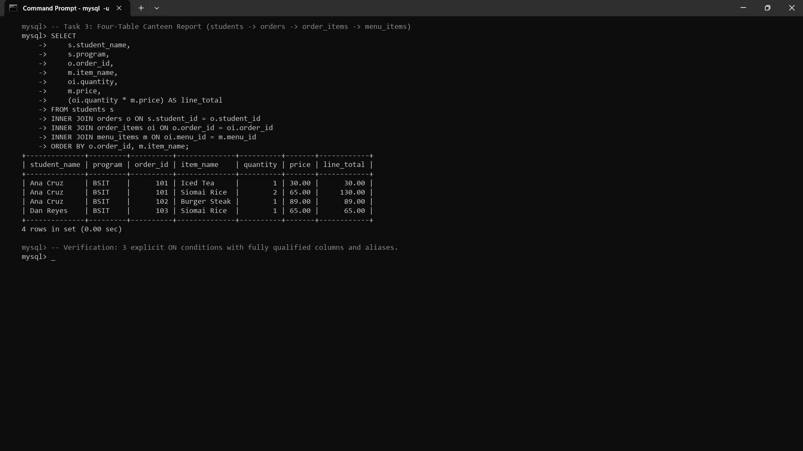
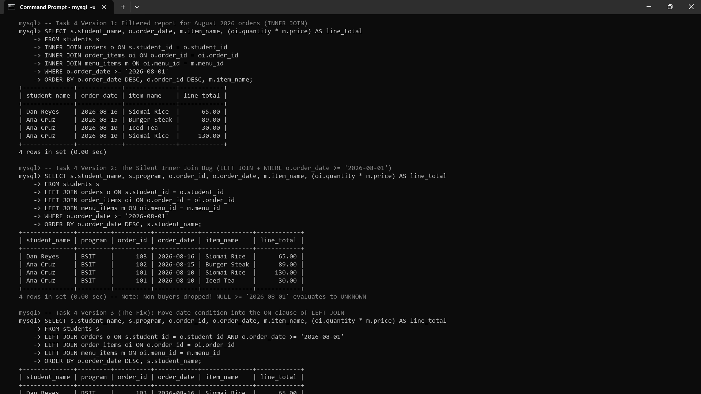

# INFOMAN1 — Week 9 Lab Answers

Name: Geoff Benedict Cariño  
Student ID: 2511028  
GitHub repo: https://github.com/geoxify/infoman1  
Date submitted: November 11, 2026  

**Database Setup Verification:**
Database: `infoman1_canteen`  
Schema Tables: `students`, `orders`, `menu_items`, `order_items`  



```text
mysql> CREATE DATABASE IF NOT EXISTS infoman1_canteen;
Query OK, 1 row affected (0.00 sec)

mysql> USE infoman1_canteen;
Database changed

mysql> SOURCE infoman1_canteen.sql;
Query OK, 0 rows affected (0.01 sec)
Query OK, 0 rows affected (0.01 sec)
Query OK, 0 rows affected (0.01 sec)
Query OK, 0 rows affected (0.01 sec)
Query OK, 4 rows affected (0.01 sec)
Records: 4  Duplicates: 0  Warnings: 0
Query OK, 3 rows affected (0.01 sec)
Records: 3  Duplicates: 0  Warnings: 0
Query OK, 3 rows affected (0.01 sec)
Records: 3  Duplicates: 0  Warnings: 0
Query OK, 4 rows affected (0.01 sec)
Records: 4  Duplicates: 0  Warnings: 0

mysql> SHOW TABLES;
+----------------------------+
| Tables_in_infoman1_canteen |
+----------------------------+
| menu_items                 |
| order_items                |
| orders                     |
| students                   |
+----------------------------+
4 rows in set (0.00 sec)

mysql> SELECT COUNT(*) AS students_count FROM students;
+----------------+
| students_count |
+----------------+
|              4 |
+----------------+
1 row in set (0.00 sec)

mysql> SELECT COUNT(*) AS orders_count FROM orders;
+--------------+
| orders_count |
+--------------+
|            3 |
+--------------+
1 row in set (0.00 sec)
```

---

## Task 1 — INNER JOIN Basics

**Approach / explanation:**
To solve this task, I constructed an `INNER JOIN` query connecting the `students` table and the `orders` table using an explicit relational join predicate in the `ON` clause (`s.student_id = o.student_id`). I projected each buyer's `student_name`, academic `program`, `order_id`, and `order_date`, ensuring all shared and source attributes were qualified with their respective table aliases (`s` and `o`). Finally, I appended an `ORDER BY o.order_id ASC` clause to sort the resulting purchases in chronological order of their unique transaction identifiers. Only students with confirmed orders (Ana Cruz and Dan Reyes) are returned, yielding exactly 3 order rows.

**Code / query used (if applicable):**
```sql
SELECT 
    s.student_name,
    s.program,
    o.order_id,
    o.order_date
FROM students s
INNER JOIN orders o 
    ON s.student_id = o.student_id
ORDER BY o.order_id;
```

**Evidence (screenshot filename, output, or file reference in this folder):**


```text
mysql> -- Task 1: INNER JOIN between students and orders on student_id
mysql> SELECT s.student_name, s.program, o.order_id, o.order_date
    -> FROM students s
    -> INNER JOIN orders o ON s.student_id = o.student_id
    -> ORDER BY o.order_id;
+--------------+---------+----------+------------+
| student_name | program | order_id | order_date |
+--------------+---------+----------+------------+
| Ana Cruz     | BSIT    |      101 | 2026-08-10 |
| Ana Cruz     | BSIT    |      102 | 2026-08-15 |
| Dan Reyes    | BSIT    |      103 | 2026-08-16 |
+--------------+---------+----------+------------+
3 rows in set (0.00 sec)
```

**Reflection question:**
*Why does an INNER JOIN hide students who never ordered, and when is that exactly the behavior a sales report wants?*

1. **Relational Set Intersection Semantics:** An `INNER JOIN` implements a strict mathematical intersection between two relations based on the join condition (`s.student_id = o.student_id`). When the database engine evaluates each candidate tuple from the `students` table against the `orders` table, any student identifier that lacks a corresponding foreign key entry in `orders` fails the equality predicate. Because an inner join retains only pairs where the predicate evaluates strictly to `TRUE`, unmatched rows from either side are automatically excluded.
2. **Business Suitability for Sales Reporting:** Hiding non-purchasing entities is precisely what a financial, billing, or inventory fulfillment report demands. A sales audit aims to analyze realized revenue, calculate average transaction values, track item turnover, or generate shipping manifests. If students with zero purchases were included, the report would contain misleading `NULL` columns for order numbers, quantities, and dates, which would distort financial aggregations (such as skewing `AVG()` calculations) and create clutter for canteen personnel fulfilling orders.

---

## Task 2 — Finding Missing Relationships

**Approach / explanation:**
For Task 2(a), I implemented a `LEFT JOIN` with `students` as the preserved left table and `orders` as the right table, joined on `s.student_id = o.student_id`. This guaranteed that all four enrolled students remained in the output regardless of transaction history, with unmatched students displaying `NULL` across the `order_id` and `order_date` fields. For Task 2(b), I extended this outer join by applying an anti-join filter in the `WHERE` clause (`WHERE o.order_id IS NULL`). This isolated only the students who have never placed an order at the canteen.

*Which students appear in (b) and why:*  
**Ben Lim (BSCS, ID 2)** and **Cara Yu (BSIS, ID 3)** appear in query (b). They appear because their primary key values (`student_id` 2 and 3) have zero corresponding foreign key occurrences in the `orders` table. When the `LEFT JOIN` executes, the database engine pads their unmatched right-table attributes with `NULL`. The predicate `WHERE o.order_id IS NULL` subsequently filters out all students with matched purchases, returning exclusively Ben and Cara.

**Code / query used (if applicable):**
```sql
-- Query 2(a): LEFT JOIN listing every student with matched orders (NULL if none)
SELECT 
    s.student_name,
    s.program,
    o.order_id,
    o.order_date
FROM students s
LEFT JOIN orders o 
    ON s.student_id = o.student_id
ORDER BY s.student_id, o.order_id;

-- Query 2(b): Filtered with WHERE o.order_id IS NULL to isolate non-buyers
SELECT 
    s.student_name,
    s.program,
    o.order_id,
    o.order_date
FROM students s
LEFT JOIN orders o 
    ON s.student_id = o.student_id
WHERE o.order_id IS NULL
ORDER BY s.student_id;
```

**Evidence (screenshot filename, output, or file reference in this folder):**


```text
mysql> -- Task 2(a): LEFT JOIN listing every student with matched orders (NULL where none exist)
mysql> SELECT s.student_name, s.program, o.order_id, o.order_date
    -> FROM students s
    -> LEFT JOIN orders o ON s.student_id = o.student_id
    -> ORDER BY s.student_id, o.order_id;
+--------------+---------+----------+------------+
| student_name | program | order_id | order_date |
+--------------+---------+----------+------------+
| Ana Cruz     | BSIT    |      101 | 2026-08-10 |
| Ana Cruz     | BSIT    |      102 | 2026-08-15 |
| Ben Lim      | BSCS    |     NULL | NULL       |
| Cara Yu      | BSIS    |     NULL | NULL       |
| Dan Reyes    | BSIT    |      103 | 2026-08-16 |
+--------------+---------+----------+------------+
5 rows in set (0.00 sec)

mysql> -- Task 2(b): Filtered with WHERE o.order_id IS NULL to isolate non-buyers
mysql> SELECT s.student_name, s.program, o.order_id, o.order_date
    -> FROM students s
    -> LEFT JOIN orders o ON s.student_id = o.student_id
    -> WHERE o.order_id IS NULL
    -> ORDER BY s.student_id;
+--------------+---------+----------+------------+
| student_name | program | order_id | order_date |
+--------------+---------+----------+------------+
| Ben Lim      | BSCS    |     NULL | NULL       |
| Cara Yu      | BSIS    |     NULL | NULL       |
+--------------+---------+----------+------------+
2 rows in set (0.00 sec)
```

**Reflection question:**
*What does NULL mean in the unmatched columns of a LEFT JOIN, and why must you test it with IS NULL instead of equals?*

1. **Semantic Meaning of NULL in Outer Joins:** In the unmatched columns of a `LEFT JOIN`, `NULL` does not represent a numerical zero, an empty string, or an intentional blank data entry. Instead, it signifies the **complete absence of a matching record** in the right-side relation. It is a sentinel placeholder injected by the SQL engine to preserve the cardinality of the left relation while indicating that no relational foreign-key pairing exists.
2. **Three-Valued Logic (3VL) and IS NULL:** SQL operates under Three-Valued Logic, where boolean expressions can evaluate to `TRUE`, `FALSE`, or `UNKNOWN`. In SQL theory, `NULL` represents an unknown value. Consequently, comparing `NULL` to anything using the standard equality operator (e.g., `o.order_id = NULL` or `o.order_id != NULL`) yields `UNKNOWN` rather than `TRUE` or `FALSE`. Because a `WHERE` clause filters out any rows whose predicate does not evaluate to strictly `TRUE`, a query using `= NULL` will always return zero rows. To test for the existence of nullness, one must use the specialized unary predicate `IS NULL` (or `IS NOT NULL`), which evaluates directly to boolean `TRUE` when an attribute contains a null marker.

---

## Task 3 — Four-Table Canteen Report

**Approach / explanation:**
To build the comprehensive four-table canteen report, I chained three sequential `INNER JOIN` operations following the database's foreign key relationships: `students` joined to `orders` via `s.student_id = o.student_id`, `orders` joined to `order_items` via `o.order_id = oi.order_id`, and `order_items` joined to `menu_items` via `oi.menu_id = m.menu_id`. I explicitly qualified all projected columns with table aliases to prevent attribute ambiguity. I computed the total price per line item using the arithmetic expression `(oi.quantity * m.price)` aliased as `line_total`, and sorted the final report by `o.order_id ASC, m.item_name ASC`.

**Code / query used (if applicable):**
```sql
SELECT 
    s.student_name,
    s.program,
    o.order_id,
    m.item_name,
    oi.quantity,
    m.price,
    (oi.quantity * m.price) AS line_total
FROM students s
INNER JOIN orders o 
    ON s.student_id = o.student_id
INNER JOIN order_items oi 
    ON o.order_id = oi.order_id
INNER JOIN menu_items m 
    ON oi.menu_id = m.menu_id
ORDER BY o.order_id, m.item_name;
```

**Evidence (screenshot filename, output, or file reference in this folder):**


```text
mysql> -- Task 3: Four-Table Canteen Report joining students, orders, order_items, menu_items
mysql> SELECT 
    ->     s.student_name,
    ->     s.program,
    ->     o.order_id,
    ->     m.item_name,
    ->     oi.quantity,
    ->     m.price,
    ->     (oi.quantity * m.price) AS line_total
    -> FROM students s
    -> INNER JOIN orders o ON s.student_id = o.student_id
    -> INNER JOIN order_items oi ON o.order_id = oi.order_id
    -> INNER JOIN menu_items m ON oi.menu_id = m.menu_id
    -> ORDER BY o.order_id, m.item_name;
+--------------+---------+----------+--------------+----------+-------+------------+
| student_name | program | order_id | item_name    | quantity | price | line_total |
+--------------+---------+----------+--------------+----------+-------+------------+
| Ana Cruz     | BSIT    |      101 | Iced Tea     |        1 | 30.00 |      30.00 |
| Ana Cruz     | BSIT    |      101 | Siomai Rice  |        2 | 65.00 |     130.00 |
| Ana Cruz     | BSIT    |      102 | Burger Steak |        1 | 89.00 |      89.00 |
| Dan Reyes    | BSIT    |      103 | Siomai Rice  |        1 | 65.00 |      65.00 |
+--------------+---------+----------+--------------+----------+-------+------------+
4 rows in set (0.00 sec)
```

**Reflection question:**
*Why does each JOIN in a multi-table chain need its own ON condition, and what goes wrong when two joins share one?*

1. **Independent Relational Linking:** In SQL relational algebra, every `JOIN` keyword incorporates an additional table into the active working relation. The corresponding `ON` condition specifies the exact predicate that binds the newly introduced table to the existing joined relations. Because each pair of tables is connected through distinct primary-key-to-foreign-key pairings (e.g. `orders` connects to `order_items` via `order_id`, while `order_items` connects to `menu_items` via `menu_id`), each join must define its own isolated predicate to establish how incoming tuples relate to the intermediate dataset.
2. **Consequences of Sharing or Omitting an ON Condition:** In ANSI SQL syntax, attempting to share an `ON` clause or omitting one causes a syntax error. If a developer mistakenly attempts to combine join predicates into a single clause or joins tables on the wrong keys, the query processor is forced to evaluate an unconstrained join, creating an accidental **Cartesian Product (CROSS JOIN)**. A Cartesian product pairs every row of the intermediate table with every row of the newly added table (producing $M \times N$ rows). In a production canteen database, this would duplicate order line items exponentially, generate wildly inflated revenue numbers, and trigger severe performance degradation.

---

## Task 4 — Aliases, Filters, and the Silent Inner Join

**Approach / explanation:**
For Task 4, I initially authored a filtered transaction report (Version 1) using `INNER JOIN` across the four tables with `WHERE o.order_date >= '2026-08-01'`, sorted newest first (`ORDER BY o.order_date DESC, o.order_id DESC, m.item_name`). I then created Version 2 by replacing the inner joins with `LEFT JOIN` operations while retaining the `WHERE o.order_date >= '2026-08-01'` predicate. Running both versions demonstrated the "Silent Inner Join" bug: Version 2 still returned only 4 rows instead of the expected 6 rows because non-purchasing students (Ben Lim and Cara Yu) have `NULL` for `o.order_date`, and the comparison `NULL >= '2026-08-01'` evaluates to `UNKNOWN`, causing the `WHERE` clause to discard them. Finally, I documented the fix (Version 3) by moving the date filtering predicate into the `ON` clause of the `LEFT JOIN`, correctly preserving all 6 rows (including Ben Lim and Cara Yu with null orders).

**Code / query used (if applicable):**
```sql
-- Version 1: Filtered report for August 2026 orders (INNER JOIN)
SELECT 
    s.student_name,
    o.order_date,
    m.item_name,
    (oi.quantity * m.price) AS line_total
FROM students s
INNER JOIN orders o 
    ON s.student_id = o.student_id
INNER JOIN order_items oi 
    ON o.order_id = oi.order_id
INNER JOIN menu_items m 
    ON oi.menu_id = m.menu_id
WHERE o.order_date >= '2026-08-01'
ORDER BY o.order_date DESC, o.order_id DESC, m.item_name;

-- Version 2: The "Silent Inner Join" (LEFT JOIN with WHERE on right-side table)
SELECT 
    s.student_name,
    s.program,
    o.order_id,
    o.order_date,
    m.item_name,
    (oi.quantity * m.price) AS line_total
FROM students s
LEFT JOIN orders o 
    ON s.student_id = o.student_id
LEFT JOIN order_items oi 
    ON o.order_id = oi.order_id
LEFT JOIN menu_items m 
    ON oi.menu_id = m.menu_id
WHERE o.order_date >= '2026-08-01'
ORDER BY o.order_date DESC, s.student_name;

-- Version 3 (The Recommended Fix): Move date condition into the ON clause
SELECT 
    s.student_name,
    s.program,
    o.order_id,
    o.order_date,
    m.item_name,
    (oi.quantity * m.price) AS line_total
FROM students s
LEFT JOIN orders o 
    ON s.student_id = o.student_id 
    AND o.order_date >= '2026-08-01'
LEFT JOIN order_items oi 
    ON o.order_id = oi.order_id
LEFT JOIN menu_items m 
    ON oi.menu_id = m.menu_id
ORDER BY o.order_date DESC, s.student_name;

-- Version 3b (Alternative Fix): Explicit NULL check in WHERE clause
SELECT 
    s.student_name,
    s.program,
    o.order_id,
    o.order_date,
    m.item_name,
    (oi.quantity * m.price) AS line_total
FROM students s
LEFT JOIN orders o 
    ON s.student_id = o.student_id
LEFT JOIN order_items oi 
    ON o.order_id = oi.order_id
LEFT JOIN menu_items m 
    ON oi.menu_id = m.menu_id
WHERE o.order_date >= '2026-08-01' 
   OR o.order_id IS NULL
ORDER BY o.order_date DESC, s.student_name;
```

**Evidence (screenshot filename, output, or file reference in this folder):**


```text
mysql> -- Task 4 Version 1: Filtered report for August 2026 orders (INNER JOIN)
mysql> SELECT s.student_name, o.order_date, m.item_name, (oi.quantity * m.price) AS line_total
    -> FROM students s
    -> INNER JOIN orders o ON s.student_id = o.student_id
    -> INNER JOIN order_items oi ON o.order_id = oi.order_id
    -> INNER JOIN menu_items m ON oi.menu_id = m.menu_id
    -> WHERE o.order_date >= '2026-08-01'
    -> ORDER BY o.order_date DESC, o.order_id DESC, m.item_name;
+--------------+------------+--------------+------------+
| student_name | order_date | item_name    | line_total |
+--------------+------------+--------------+------------+
| Dan Reyes    | 2026-08-16 | Siomai Rice  |      65.00 |
| Ana Cruz     | 2026-08-15 | Burger Steak |      89.00 |
| Ana Cruz     | 2026-08-10 | Iced Tea     |      30.00 |
| Ana Cruz     | 2026-08-10 | Siomai Rice  |     130.00 |
+--------------+------------+--------------+------------+
4 rows in set (0.00 sec)

mysql> -- Task 4 Version 2: The Silent Inner Join Bug (LEFT JOIN + WHERE o.order_date >= '2026-08-01')
mysql> SELECT s.student_name, s.program, o.order_id, o.order_date, m.item_name, (oi.quantity * m.price) AS line_total
    -> FROM students s
    -> LEFT JOIN orders o ON s.student_id = o.student_id
    -> LEFT JOIN order_items oi ON o.order_id = oi.order_id
    -> LEFT JOIN menu_items m ON oi.menu_id = m.menu_id
    -> WHERE o.order_date >= '2026-08-01'
    -> ORDER BY o.order_date DESC, s.student_name;
+--------------+---------+----------+------------+--------------+------------+
| student_name | program | order_id | order_date | item_name    | line_total |
+--------------+---------+----------+------------+--------------+------------+
| Dan Reyes    | BSIT    |      103 | 2026-08-16 | Siomai Rice  |      65.00 |
| Ana Cruz     | BSIT    |      102 | 2026-08-15 | Burger Steak |      89.00 |
| Ana Cruz     | BSIT    |      101 | 2026-08-10 | Siomai Rice  |     130.00 |
| Ana Cruz     | BSIT    |      101 | 2026-08-10 | Iced Tea     |      30.00 |
+--------------+---------+----------+------------+--------------+------------+
4 rows in set (0.00 sec) -- Note: Non-buyers dropped! NULL >= '2026-08-01' evaluates to UNKNOWN

mysql> -- Task 4 Version 3 (The Fix): Move date condition into the ON clause of LEFT JOIN
mysql> SELECT s.student_name, s.program, o.order_id, o.order_date, m.item_name, (oi.quantity * m.price) AS line_total
    -> FROM students s
    -> LEFT JOIN orders o ON s.student_id = o.student_id AND o.order_date >= '2026-08-01'
    -> LEFT JOIN order_items oi ON o.order_id = oi.order_id
    -> LEFT JOIN menu_items m ON oi.menu_id = m.menu_id
    -> ORDER BY o.order_date DESC, s.student_name;
+--------------+---------+----------+------------+--------------+------------+
| student_name | program | order_id | order_date | item_name    | line_total |
+--------------+---------+----------+------------+--------------+------------+
| Dan Reyes    | BSIT    |      103 | 2026-08-16 | Siomai Rice  |      65.00 |
| Ana Cruz     | BSIT    |      102 | 2026-08-15 | Burger Steak |      89.00 |
| Ana Cruz     | BSIT    |      101 | 2026-08-10 | Siomai Rice  |     130.00 |
| Ana Cruz     | BSIT    |      101 | 2026-08-10 | Iced Tea     |      30.00 |
| Ben Lim      | BSCS    |     NULL | NULL       | NULL         |       NULL |
| Cara Yu      | BSIS    |     NULL | NULL       | NULL         |       NULL |
+--------------+---------+----------+------------+--------------+------------+
6 rows in set (0.00 sec) -- Preserved non-buyers Ben Lim and Cara Yu
```

**Row Count Difference & Analysis:**
- **Version 1 (INNER JOIN):** Produces **4 rows** (Ana Cruz with 3 order items and Dan Reyes with 1 order item). Non-buyers Ben Lim and Cara Yu are excluded by definition of the inner join.
- **Version 2 (LEFT JOIN with WHERE):** Produces **4 rows**, exactly identical to Version 1! Although the query begins with `LEFT JOIN`, placing `WHERE o.order_date >= '2026-08-01'` causes the database engine to test the condition against all rows after the join. For Ben Lim and Cara Yu, `o.order_date` is `NULL`. Under SQL Three-Valued Logic, `NULL >= '2026-08-01'` evaluates to `UNKNOWN`, which the `WHERE` clause rejects. Thus, Ben and Cara are silently eliminated, converting the outer join into an inner join.
- **Version 3 (The Fix):** Produces **6 rows** (4 purchase rows + 2 non-buyer rows). By placing `AND o.order_date >= '2026-08-01'` inside the `ON` clause, the date filter is evaluated *during* table matching rather than after. When an order date does not match or a student has no orders, the outer join still retains the student record from `students` and populates the remaining fields with `NULL`.

**Reflection question:**
*Why does adding WHERE on the right-side table remove the NULL rows a LEFT JOIN just preserved, and where should that rule live instead?*

1. **SQL Logical Query Processing Order:** In the SQL processing pipeline, the `FROM` and `JOIN` clauses execute first, generating an intermediate working relation where unmatched left-table records are padded with `NULL` for all right-table attributes. The `WHERE` clause executes immediately after this joined table is constructed. Any filter placed in `WHERE` acts as a global row gatekeeper. When a condition evaluates an attribute belonging to the right-side table (such as `o.order_date >= '2026-08-01'`), rows representing unmatched left-side records contain `NULL` in that position. Because any boolean expression comparing `NULL` with a literal value evaluates to `UNKNOWN`, and `WHERE` filters accept exclusively rows that evaluate to `TRUE`, all `NULL`-padded rows are discarded.
2. **Correct Placement of the Filtering Rule:** To preserve the outer join's behavior, the filtering rule must be placed directly inside the `ON` clause of the `LEFT JOIN` (e.g. `LEFT JOIN orders o ON s.student_id = o.student_id AND o.order_date >= '2026-08-01'`). Inside the `ON` clause, a predicate failure does not eliminate the left-table row; it simply determines that no right-table row qualifies for matching, allowing the SQL engine to proceed with its normal outer join operation of padding the right-side attributes with `NULL` while retaining the left-side entity. Alternatively, if the rule must remain in `WHERE`, it must explicitly permit nulls via `OR o.order_id IS NULL`.

---

## Task 5 — Reflection

**Approach / explanation:**
To complete this task, I evaluated the core architectural distinctions between `INNER JOIN` and `LEFT JOIN` in enterprise database systems, grounding the analysis in the concrete queries executed in Tasks 1 through 4. I specifically focused on real-world edge cases where subtle structural bugs—such as the silent inner join and Cartesian expansion—cause serious operational failures in campus reporting. I then documented the practical diagnostic indicators and corrective measures necessary to maintain query integrity.

**Code / query used (if applicable):**
```sql
-- Architectural Fix: Relocating right-side predicate to ON clause to preserve outer join integrity
SELECT s.student_name, s.program, o.order_id, o.order_date, m.item_name, (oi.quantity * m.price) AS line_total
FROM students s
LEFT JOIN orders o ON s.student_id = o.student_id AND o.order_date >= '2026-08-01'
LEFT JOIN order_items oi ON o.order_id = oi.order_id
LEFT JOIN menu_items m ON oi.menu_id = m.menu_id
ORDER BY o.order_date DESC, s.student_name;
```

**Evidence (screenshot filename, output, or file reference in this folder):**
*Reflective Essay (Word count: 182 words):*

When architecting campus reports, the choice between `INNER JOIN` and `LEFT JOIN` hinges on whether unassociated entities represent valid business data or noise. For a canteen financial audit or kitchen preparation manifest (as in Task 3), I choose `INNER JOIN` because operations require verified transactions; students who never purchased food would inject superfluous `NULL` rows that distort sales totals and average order metrics. Conversely, for an administrative student engagement roster or financial aid audit, I choose `LEFT JOIN` (as demonstrated in Task 2a and Task 4) to ensure non-participating students like Ben Lim and Cara Yu remain visible for outreach and follow-up.

A critical mistake I observed occurs when filtering outer joins by placing date constraints on the right-side table within the `WHERE` clause (e.g., `WHERE o.order_date >= '2026-08-01'`). The symptom was the silent disappearance of non-purchasing students, causing the expected six-row roster to collapse into four rows. Because non-buyers possess `NULL` order dates, evaluating `NULL >= '2026-08-01'` returned `UNKNOWN`, silently discarding them. I resolved this bug by relocating the filter directly into the `LEFT JOIN`'s `ON` clause, preserving unmatched student records.

**Reflection question:**
*Which join would you choose for an "all students including non-buyers" roster versus a "completed sales only" report, and what single symptom would tell you that you picked the wrong one?*

1. **Join Selection by Business Use Case:**
   - **"All Students Including Non-Buyers" Roster:** Choose **`LEFT JOIN`** starting from the primary master entity (`students`). This guarantees every enrolled student is represented on the roster, with non-purchasing students displaying `NULL` for transaction attributes, which is essential for campus engagement tracking, meal voucher eligibility, and non-participant surveys.
   - **"Completed Sales Only" Report:** Choose **`INNER JOIN`**. Because accounting, revenue reconciliation, and canteen kitchen workflows focus strictly on realized economic events, an inner join ensures every row corresponds to an authentic transaction, preventing invalid null line items from contaminating sales summaries.
2. **The Single Diagnostic Symptom:**
   - If you mistakenly use an `INNER JOIN` for an "all students" roster, the definitive symptom is an **artificially suppressed row count** where the total output rows are fewer than the total records in the student master table (`COUNT(DISTINCT s.student_id) < total_enrolled_students`), indicating non-purchasing students have been silently deleted from the report.
   - Conversely, if you mistakenly use a `LEFT JOIN` for a "completed sales only" report, the giveaway symptom is the presence of **spurious rows containing `NULL` in the primary key of the transactions table** (`order_id IS NULL`), which results in blank line items, erroneous invoice counts, and distorted financial aggregates.

---

## Self-Check

- [x] All tasks committed with individual, meaningful commit messages
- [x] All files placed inside `week9/`
- [x] This file completed and renamed `answers.md`
- [x] Repository link pasted into Moodle (no files uploaded)
